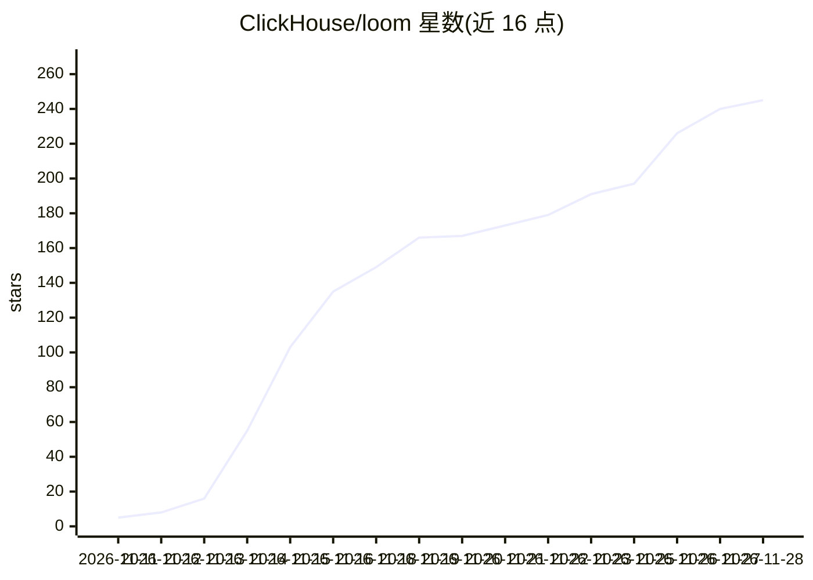

# ClickHouse/loom

⭐ 245 · Python · Apache-2.0 · 推送 2026-11-27 · [GitHub](https://github.com/ClickHouse/loom) · [官网](https://loom.clickhouse.com/docs) · 组织维护

**自托管的 AI agent 共享长期记忆与代码索引服务**

开源自托管的 MCP 服务器，为 AI agent 提供跨会话共享的长期记忆：一个 agent 学到的内容可被其他 agent 或工具检索。记忆关联到具体文件与代码符号，并在 agent 读取或编辑时浮现；还提供带引用的文档搜索（RAG）与仓库代码索引（定义/调用者/变更影响）。通过 MCP、HTTP、Python/TypeScript SDK 接入，数据存于 ClickHouse，支持 Docker 安装脚本或 Helm 部署，带命名空间、角色与 token 的多用户模式及仪表盘。默认本地嵌入模型、无 key 也可运行结构化功能。

## 筛选速览

| 维度 | 判定 | 备注 |
|---|---|---|
| AI 角色 | `ai-ecosystem` | LLM/agent 周边工具 |
| 许可风险 | `permissive` | Apache-2.0 |
| 部署形态 | `self-host` | docker 或自建部署 |
| 模型依赖 | — | README 未给出锁定关系 |
| 硬件要求 | — | 无带数字的原话,不猜 |
| 安装摩擦 | `low` | 无编译、无系统依赖或容器化 |
| 成熟度 | — | 结构信号不足 |

## 能力要点

- 跨 agent 共享长期记忆，关联文件与符号并随重构跟踪
- 代码索引支持查询定义、调用者与变更影响
- 带文档/修订/行级引用的文档搜索（支持 PDF、docx、pptx）
- 命名空间、角色与 token 的多用户模式，可回滚到任意时间点

## 适用场景

- 为 Claude Code/Codex/Cursor 等 coding agent 提供跨会话记忆
- 团队部署多用户 MCP 记忆服务器，按命名空间隔离
- 为仓库建立代码索引供 agent 查询定义与调用者
- 将运行手册与经验转为有来源支撑的知识库

## 场景标签

`Agent 记忆` `RAG` · 领域:Agent 开发

## 证据(README 行号)

> L26: Loom is an open-source, self-hosted MCP server that gives your agents long-term, shared
> L31: Agents connect through MCP, HTTP, Python or TypeScript. Self-host with Docker or
> L48: - **A multi-user MCP memory server** with namespaces, roles and tokens.

## 星数曲线

2026-11-11 5 → 2026-11-28 245（+240）

---
*卡片 v1 · prompt 1.4 · 生成 2026-11-27 · 置信度 mid · 依据 README sha `0e1ea68e3aba` · [字段定义](../../DATASET.md)*
