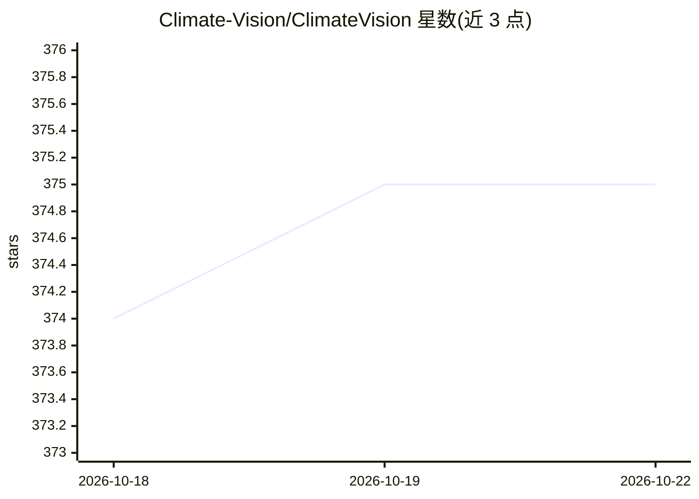

# Climate-Vision/ClimateVision

⭐ 376 · Python · MIT · 推送 2026-08-28 · [GitHub](https://github.com/Climate-Vision/ClimateVision) · 组织维护

**卫星影像环境变化检测平台：监测毁林、冰融与洪水**

基于 PyTorch 的开源机器学习平台，用 U-Net 语义分割与孪生网络变化检测，从 Sentinel-2/Landsat 影像识别毁林、北极冰融与洪水三类环境变化。数据管道接入 Google Earth Engine，含云掩膜、归一化与 256×256 切片。以 FastAPI REST API 运行，配 React 仪表盘、区域订阅与阈值告警、MLflow 实验跟踪与 ONNX 导出。干旱与野火检测为规划功能，性能基准（IoU/F1）尚标注为进行中。面向保护组织与研究人员。

## 筛选速览

| 维度 | 判定 | 备注 |
|---|---|---|
| AI 角色 | `ai-native` | 本体是模型或模型工具 |
| 许可风险 | `permissive` | MIT |
| 部署形态 | `library` | 以包/库形式分发 |
| 模型依赖 | — | README 未给出锁定关系 |
| 硬件要求 | — | 无带数字的原话,不猜 |
| 安装摩擦 | `low` | 无编译、无系统依赖或容器化 |
| 成熟度 | — | 结构信号不足 |

## 能力要点

- U-Net 语义分割 + 孪生网络变化检测三类环境变化
- Google Earth Engine 数据管道（云掩膜/归一化/256×256 切片）
- FastAPI REST API + React 仪表盘（区域订阅与阈值告警）
- MLflow 实验跟踪与 ONNX 模型导出

## 适用场景

- 保护区自动监测毁林并接收邮件/webhook 告警
- 研究人员对冰川或洪涝区域做变化检测分析
- 环保 NGO 订阅重点区域并查看历史运行与统计

## 场景标签

`目标检测` · 领域:感知与多模态

## 证据(README 行号)

> L11: ClimateVision is an open-source machine learning platform that detects environmental change from satellite imagery.
> L50: - **Deep learning inference** — U-Net semantic segmentation and Siamese network change detection on Sentinel-2 imag

## 星数曲线

2026-10-18 374 → 2026-10-22 375（+1）

---
*卡片 v1 · prompt 1.4 · 生成 2026-10-21 · 置信度 mid · 依据 README sha `f2fe930b2d23` · [字段定义](../../DATASET.md)*
