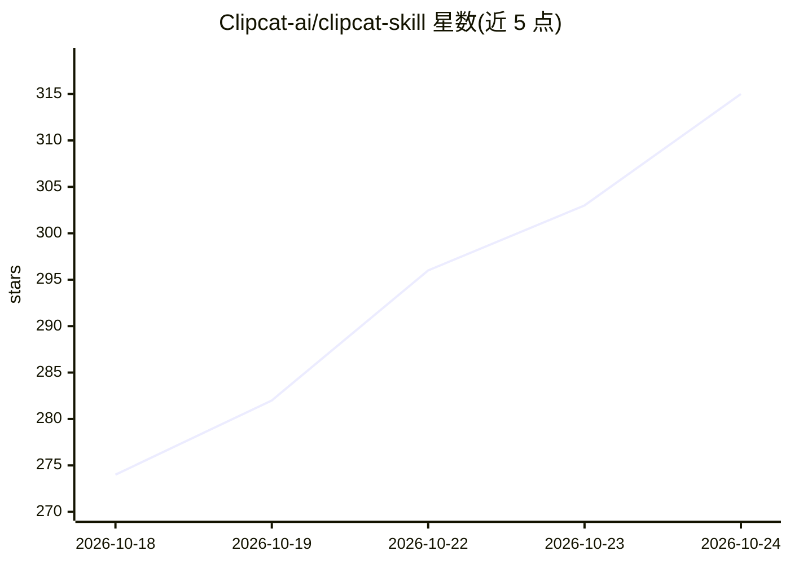

# Clipcat-ai/clipcat-skill

⭐ 320 · 推送 2026-10-24 · [GitHub](https://github.com/Clipcat-ai/clipcat-skill) · [官网](https://clipcat.ai) · 组织维护 · 中文 README

**让 AI agent 生成/复制/发布 TikTok 带货视频的 CLI 技能**

面向可执行 shell 命令的 AI agent 的技能包：提供一个 clipcat CLI 与 SKILL.md 清单，agent 读取后可调用其命令完成 TikTok 电商数据查询（创作者/商品/店铺/视频/直播六大域）、从 5000+ 真实高 GMV 带货视频库检索并改写出可拍摄脚本提示词、复刻爆款视频、商品图生成 UGC 视频、AI 生图（GPT Image 2）、发布到 TikTok 与视频下载。视频/图片生成经 Clipcat API 异步提交，按模型/时长/分辨率计费，消费积分前需用户确认；支持 10 余种视频模型（Grok Imagine、Veo 3.1、Seedance 2 等），需注册获取 API key。

## 筛选速览

| 维度 | 判定 | 备注 |
|---|---|---|
| AI 角色 | `ai-native` | 本体是模型或模型工具 |
| 许可风险 | `none` | — |
| 部署形态 | `None` |  |
| 模型依赖 | — | README 未给出锁定关系 |
| 硬件要求 | — | 无带数字的原话,不猜 |
| 安装摩擦 | `low` | 无编译、无系统依赖或容器化 |
| 成熟度 | — | 结构信号不足 |

## 能力要点

- 六大 TikTok 电商实体域的数据查询与跨实体关系检索
- 基于真实高 GMV 带货视频逆向提示词库的爆款脚本生成
- 商品图转 UGC 视频与爆款视频复刻（本地文件最大 100MB）
- 视频发布到自有 TikTok 账号（支持定时与草稿箱，不耗积分）

## 适用场景

- 让我的 agent 查 TikTok Shop 爆款视频和竞品店铺数据
- 用自己产品的图片复刻一条已验证的带货视频
- 生成带货视频并定时发布到我的 TikTok 账号

## 场景标签

`视频生成` `图像生成` · 领域:内容生成

## 证据(README 行号)

> L3: **Turn any AI agent into a TikTok Shop video producer.** Find viral TikTok videos, research TikTok Shop products, sh
> L27: - **Product to Video**: Turn product images into UGC-style TikTok videos
> L28: - **AI Image Generation**: Generate AI images from text prompts using GPT Image 2 / GPT Image 2.5 (Flare / Sunburst

## 星数曲线

2026-10-18 274 → 2026-10-24 315（+41）

---
*卡片 v1 · prompt 1.4 · 生成 2026-10-21 · 置信度 high · 依据 README sha `7680ec7d3c7c` · [字段定义](../../DATASET.md)*
