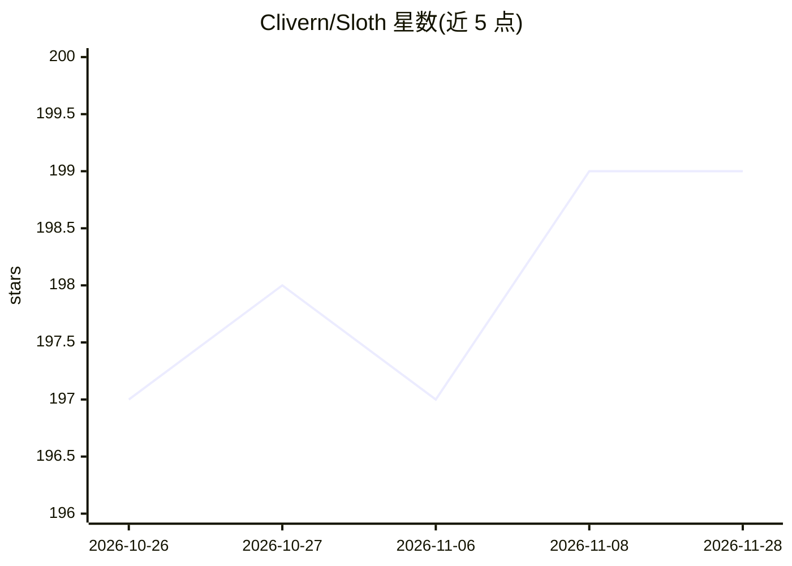

# Clivern/Sloth

⭐ 199 · Go · Apache-2.0 · 推送 2026-11-27 · [GitHub](https://github.com/Clivern/Sloth) · [官网](https://sloth.clivern.com) · 个人维护

**面向 AI 代理、API 与 MCP 服务器的多租户网关**

Sloth 是一个多租户网关与服务发现注册表，统一管理 AI 代理、API 与 MCP 服务器：注册 AI 代理后可相互发现，所有调用经由单一网关路由，由网关处理负载均衡、健康检查与策略控制。项目遵循语义化版本规范发布，通过 GitHub Releases 提供变更日志与路线图，安全漏洞通过邮件报告，采用 MIT 许可证发布。

## 筛选速览

| 维度 | 判定 | 备注 |
|---|---|---|
| AI 角色 | `ai-ecosystem` | LLM/agent 周边工具 |
| 许可风险 | `permissive` | Apache-2.0 |
| 部署形态 | `None` |  |
| 模型依赖 | — | README 未给出锁定关系 |
| 硬件要求 | — | 无带数字的原话,不猜 |
| 安装摩擦 | `low` | 无编译、无系统依赖或容器化 |
| 成熟度 | — | 结构信号不足 |

## 能力要点

- 多租户网关统一路由 AI 代理、API 与 MCP 服务器的调用
- 服务发现注册表支持 AI 代理相互发现
- 网关内置负载均衡、健康检查与策略控制

## 适用场景

- 为多个 AI 代理提供统一的服务发现与互相发现
- 通过单一网关统一管理 MCP 服务器与 API 的流量
- 需要对 AI 服务调用做负载均衡与健康检查的微服务部署

## 场景标签

 · 领域:AI 基础设施/网关

## 证据(README 行号)

> L15: Sloth is a multi-tenant gateway and service discovery registry for AI agents, APIs and MCP servers. Register your A

## 星数曲线

2026-10-26 197 → 2026-11-28 199（+2）

---
*卡片 v1 · prompt 1.4 · 生成 2026-11-25 · 置信度 high · 依据 README sha `907bec205485` · [字段定义](../../DATASET.md)*
