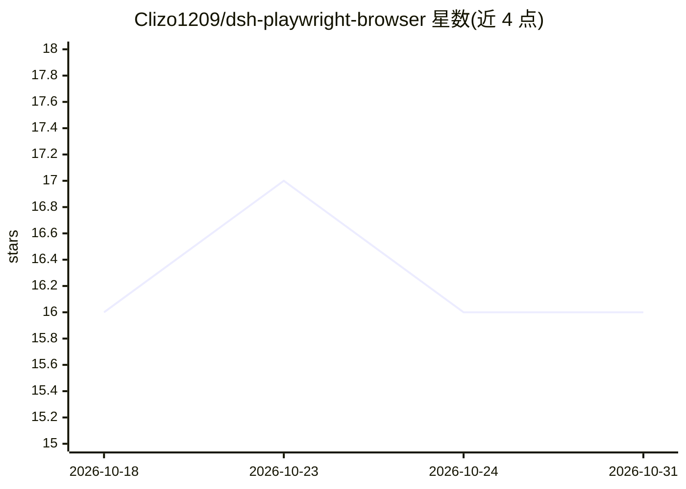

# Clizo1209/dsh-playwright-browser

⭐ 16 · TypeScript · MIT · 推送 2026-08-14 · [GitHub](https://github.com/Clizo1209/dsh-playwright-browser) · [官网](https://www.npmjs.com/package/dsh-playwright-browser) · 个人维护 · 中文 README

**为 DeepSeek Harness 提供浏览器自动化的插件**

面向 DeepSeek Harness（DSH）的 Playwright 浏览器自动化插件：向 DSH 工具注册表注册 browser_open、browser_click、browser_snapshot 等十个 browser_* 工具，支持持久化浏览器上下文、稳定标签页标识、无障碍/可见文本快照、语义定位器（role=button|Save 等）、PNG 截图与导航历史。浏览器可回退到已安装的 Chrome 或 Edge；安全模型将页面内容视为不可信数据，敏感操作需用户授权。README 声明 DSH 尚处开发者预览阶段，插件针对 DSH 0.1.0-rc.6 测试。

## 筛选速览

| 维度 | 判定 | 备注 |
|---|---|---|
| AI 角色 | `ai-ecosystem` | LLM/agent 周边工具 |
| 许可风险 | `permissive` | MIT |
| 部署形态 | `library` | 以包/库形式分发 |
| 模型依赖 | locked-api |  |
| 硬件要求 | — | 无带数字的原话,不猜 |
| 安装摩擦 | `low` | 无编译、无系统依赖或容器化 |
| 成熟度 | `idea` | |

## 能力要点

- 注册 10 个 browser_* 工具到 DSH 工具注册表
- 语义定位器与快照简写（role=button|Save、button|Save）
- Playwright Chromium 失败时回退到已安装 Chrome/Edge
- 安全模型：页面内容不作为指令、拒绝带凭据 URL、敏感操作需授权

## 适用场景

- 让 DSH agent 在浏览器中执行多标签页自动化任务
- 为 agent 提供带语义定位与截图的网页操作工具
- 以无头或有头模式配置专属自动化浏览器环境

## 场景标签

`浏览器自动化` · 领域:效率与自动化

## 证据(README 行号)

> L7: Semantic, multi-tab browser automation for DeepSeek Harness (DSH), powered by Playwright.
> L16: - Ten native `browser_*` tools registered in the DSH tool registry.

## 星数曲线

2026-10-18 16 → 2026-10-31 16（+0）

---
*卡片 v1 · prompt 1.4 · 生成 2026-10-30 · 置信度 high · 依据 README sha `b0a57c06141d` · [字段定义](../../DATASET.md)*
