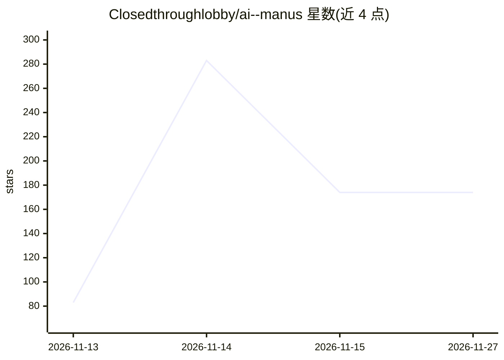

# Closedthroughlobby/ai--manus

⭐ 174 · Apache-2.0 · 推送 2026-11-15 · [GitHub](https://github.com/Closedthroughlobby/ai--manus) · 个人维护

**面向日常小任务的自主 AI Agent：自动执行代码与控制浏览器**

README 以宣传性文字描述的自主 AI Agent 产品：宣称可代替用户编写并执行脚本、操控浏览器（导航网页、填写表单、抓取信息）、执行多步骤任务，并以个人助手形式在后台待命。定位为家庭、学习与轻量办公场景的小型助手，非企业平台。文档未给出任何安装命令、源码入口、技术架构或模型接入细节，仅列出兼容性配置表与使用步骤建议，内容可验证度有限。

## 筛选速览

| 维度 | 判定 | 备注 |
|---|---|---|
| AI 角色 | `ai-native` | 本体是模型或模型工具 |
| 许可风险 | `permissive` | Apache-2.0 |
| 部署形态 | `None` |  |
| 模型依赖 | — | README 未给出锁定关系 |
| 硬件要求 | — | 无带数字的原话,不猜 |
| 安装摩擦 | `low` | 无编译、无系统依赖或容器化 |
| 成熟度 | — | 结构信号不足 |

## 能力要点

- 宣称支持自主执行代码与浏览器操控
- 宣称支持多步骤任务与跨会话保持工作流模式
- 面向学习、家庭项目与轻量办公的小规模场景

## 适用场景

- 让学生整理研究资料、运行小脚本
- 让代理代为浏览网页、填表与汇总信息
- 把重复性小任务交给后台代理处理

## 场景标签

`AI 助手` `浏览器自动化` · 领域:效率与自动化

## 证据(README 行号)

> L18: Manus is an autonomous AI agent designed to run code and control a browser on your behalf. Instead of acting like a
> L22: Manus is not a heavy studio suite or a complex enterprise platform. It is a focused helper built for home, study, a

## 星数曲线

2026-11-13 83 → 2026-11-27 174（+91）

---
*卡片 v1 · prompt 1.4 · 生成 2026-11-17 · 置信度 low · 依据 README sha `0f78ee3a5dd2` · [字段定义](../../DATASET.md)*
