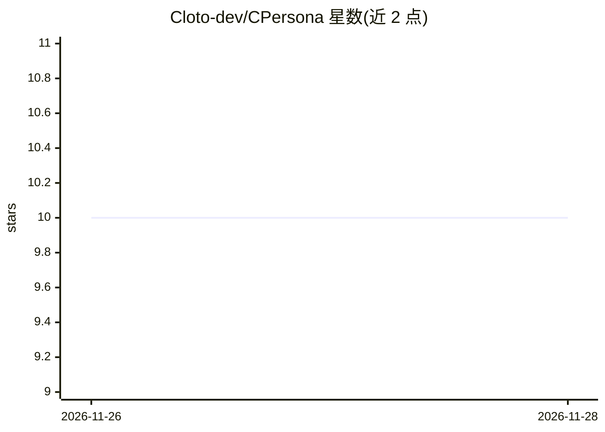

# Cloto-dev/CPersona

⭐ 10 · Python · MIT · 推送 2026-11-26 · [GitHub](https://github.com/Cloto-dev/CPersona) · [官网](https://pypi.org/project/cpersona/) · 组织维护 · 中文 README

**MCP 服务器：为 AI agent 提供本地 SQLite 长期记忆**

CPersona 是一个 MCP 服务器，供 Claude Code、Codex、Claude Desktop、Cursor、VS Code 等 MCP 客户端在会话间持久保存与读取记忆。数据存于用户本地的单个 SQLite 文件，检索同时运行向量、全文与关键词三路搜索；存储与召回过程不调用生成式模型，摘要由 agent 自己写入。无嵌入服务器时退化为关键词搜索并在每次召回时如实提示。提供只读 dashboard 查看存储内容，按 agent/project_id/channel 隔离数据。MIT 许可，文档含日文版。

## 筛选速览

| 维度 | 判定 | 备注 |
|---|---|---|
| AI 角色 | `ai-ecosystem` | LLM/agent 周边工具 |
| 许可风险 | `permissive` | MIT |
| 部署形态 | `library` | 以包/库形式分发 |
| 模型依赖 | — | README 未给出锁定关系 |
| 硬件要求 | — | 无带数字的原话,不猜 |
| 安装摩擦 | `low` | 无编译、无系统依赖或容器化 |
| 成熟度 | — | 结构信号不足 |

## 能力要点

- 单 SQLite 文件本地存储，无账号无云端，可用 sqlite3 .backup 备份
- 向量 + 全文 + 关键词混合检索，覆盖日文等无空格文字
- reconstruct 工具引用存储记录，答案可溯源
- 嵌入服务器缺失时降级为关键词搜索并明确提示

## 适用场景

- 让编码 agent 跨会话记住决策与上下文
- 多个 agent 与项目共享一套记忆库而不混淆
- 本地化保存 agent 记忆数据以便备份与审查

## 场景标签

`Agent 记忆` · 领域:Agent 开发

## 证据(README 行号)

> L5: CPersona is an MCP server that lets Claude Code, Codex, Claude Desktop, Cursor, VS Code
> L23: - **No language model inside.** CPersona never calls a generative model to store or recall.
> L27: - **Search that catches what vectors miss.** Vector search runs beside full-text and keyword

## 星数曲线

2026-11-26 10 → 2026-11-28 10（+0）

---
*卡片 v1 · prompt 1.4 · 生成 2026-11-26 · 置信度 high · 依据 README sha `f665a7356d15` · [字段定义](../../DATASET.md)*
