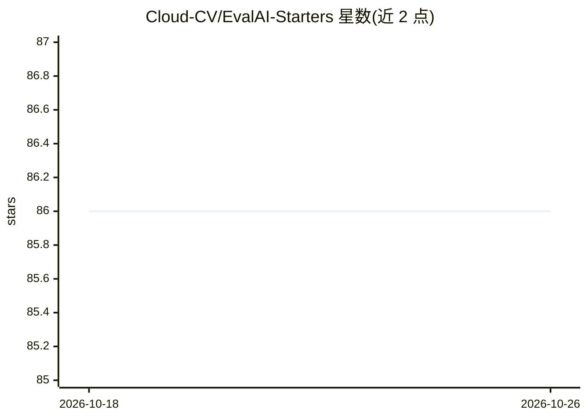

# Cloud-CV/EvalAI-Starters

⭐ 86 · Python · 推送 2026-03-26 · [GitHub](https://github.com/Cloud-CV/EvalAI-Starters) · 组织维护

**EvalAI 竞赛创建模板仓库：快速搭建 AI 评测挑战**

Cloud-CV 维护的模板仓库，用于在 EvalAI 平台上创建数据科学/机器学习竞赛挑战。提供标注数据目录结构、挑战配置 yaml、HTML 模板与评测脚本的可复制框架；通过 GitHub fork、配置 auth token 与 host_team_pk、推送 challenge 分支自动同步到 EvalAI。支持本地运行评测脚本（python -m worker.run）与自托管 runner 对接本地 EvalAI 服务器（docker-compose 启动）进行测试。

## 筛选速览

| 维度 | 判定 | 备注 |
|---|---|---|
| AI 角色 | `ai-ecosystem` | LLM/agent 周边工具 |
| 许可风险 | `none` | — |
| 部署形态 | `self-host` | docker 或自建部署 |
| 模型依赖 | — | README 未给出锁定关系 |
| 硬件要求 | — | 无带数字的原话,不猜 |
| 安装摩擦 | `low` | 无编译、无系统依赖或容器化 |
| 成熟度 | — | 结构信号不足 |

## 能力要点

- GitHub 模板仓库方式创建 EvalAI 挑战，challenge 分支自动同步
- 本地测试评测脚本：python -m worker.run
- 支持自托管 runner 对接本地 docker-compose 启动的 EvalAI 服务器
- 推送配置出错时自动在仓库开 issue 报告错误

## 适用场景

- 为我的数据集在 EvalAI 上快速搭建一个评测竞赛
- 在推送到线上前本地验证评测脚本是否正确
- 用自托管 runner 对本地 EvalAI 服务器做完整流程测试

## 场景标签

`模型评测` · 领域:评测与运维

## 证据(README 行号)

> L1: ## How to create a challenge on EvalAI?
> L3: If you are looking for a simple challenge configuration that you can replicate to create a challenge on EvalAI, then
> L22: 4. Now, go to EvalAI to fetch the following details -

## 星数曲线

2026-10-18 86 → 2026-10-26 86（+0）

---
*卡片 v1 · prompt 1.4 · 生成 2026-10-24 · 置信度 mid · 依据 README sha `8454e465f3c5` · [字段定义](../../DATASET.md)*
