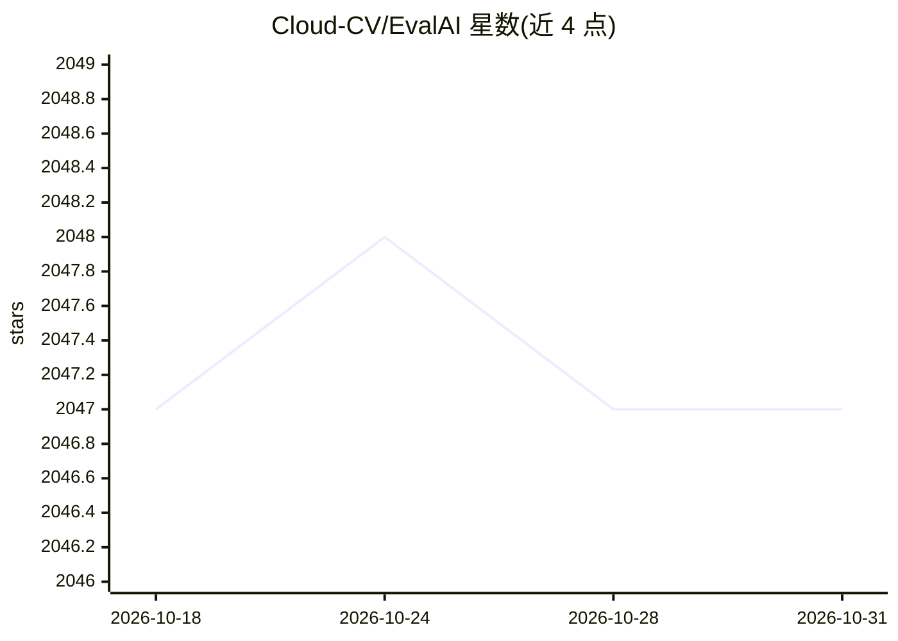

# Cloud-CV/EvalAI

⭐ 2,047 · Python · NOASSERTION · 推送 2026-10-29 · [GitHub](https://github.com/Cloud-CV/EvalAI) · [官网](https://eval.ai) · 组织维护

**面向研究者的 AI 算法评测与竞赛平台**

开源的机器学习/人工智能算法大规模评测与对比平台：提供中央排行榜与提交接口，支持自定义评测阶段与数据集切分、公私排行榜、远程评测（组织方接入自有计算集群）、以 Docker 镜像形式提交 agent 代码并在测试环境中评测。技术栈基于 Django、Node.js、PostgreSQL 与 Docker，worker 启动时预加载数据集并分片多核评测。面向举办 AI 竞赛的研究者与机构，另有 evalai-cli 命令行工具，自托管通过 docker-compose 完成。

## 筛选速览

| 维度 | 判定 | 备注 |
|---|---|---|
| AI 角色 | `ai-ecosystem` | LLM/agent 周边工具 |
| 许可风险 | `none` | NOASSERTION |
| 部署形态 | `self-host` | docker 或自建部署 |
| 模型依赖 | — | README 未给出锁定关系 |
| 硬件要求 | — | 无带数字的原话,不猜 |
| 安装摩擦 | `low` | 无编译、无系统依赖或容器化 |
| 成熟度 | — | 结构信号不足 |

## 能力要点

- 中央排行榜与统一提交接口，支持自定义评测阶段与数据集切分
- 远程评测：组织方可接入自有 worker 集群处理大规模提交
- 参与者以 Docker 镜像提交 agent，在测试环境容器中评测
- worker 预加载挑战代码与数据集并分片多核评测

## 适用场景

- 我作为研究者想举办 AI 竞赛并维护可信的排行榜
- 我想把论文中的算法结果在统一数据切分与指标下复现对比
- 我需要让参与者提交 agent 代码在隔离容器中评测

## 场景标签

`模型评测` · 领域:评测与运维

## 证据(README 行号)

> L13: EvalAI is an open source platform for evaluating and comparing machine learning (ML) and artificial intelligence (A
> L15: In recent years, it has become increasingly difficult to compare an algorithm solving a given task with other exist

## 星数曲线

2026-10-18 2,047 → 2026-10-31 2,047（+0）

---
*卡片 v1 · prompt 1.4 · 生成 2026-10-21 · 置信度 high · 依据 README sha `3649839d7004` · [字段定义](../../DATASET.md)*
