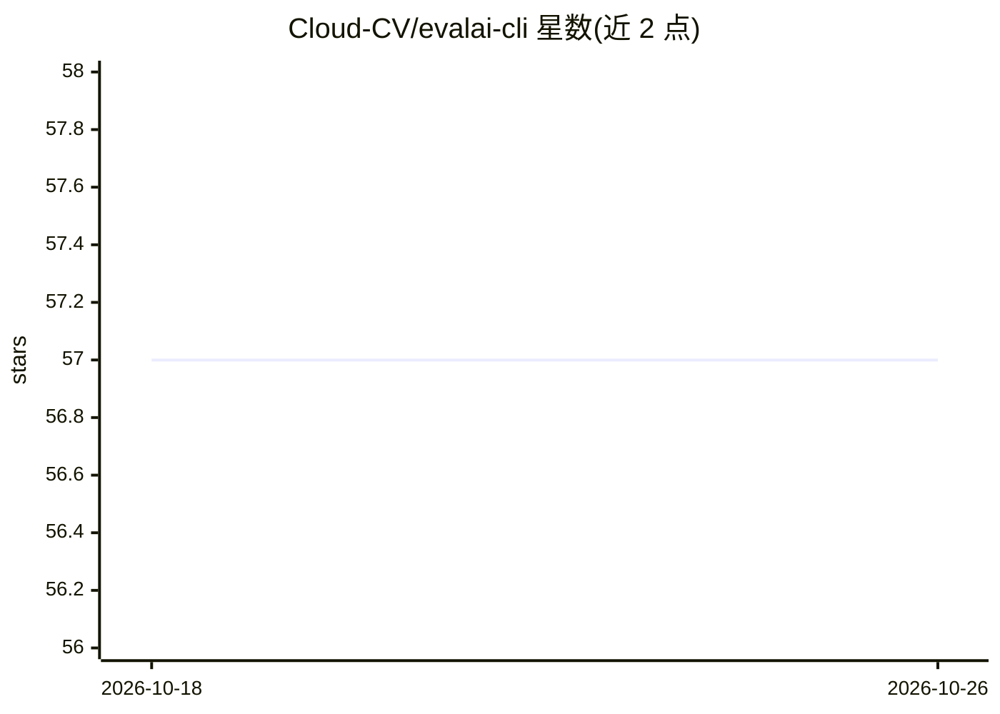

# Cloud-CV/evalai-cli

⭐ 57 · Python · BSD-3-Clause · 推送 2026-06-14 · [GitHub](https://github.com/Cloud-CV/evalai-cli) · [官网](https://cli.eval.ai) · 组织维护

**EvalAI 平台官方命令行工具：在终端使用评测平台**

EvalAI-CLI 是 EvalAI（AI 挑战赛/评测平台）的官方命令行工具，将 Web 应用功能延伸到终端，供参与者和主办方通过命令行与 EvalAI 平台交互（如切换 host、登录账号）。基于 Python 3，通过 pip 安装，支持 git clone 源码开发并配置本地 EvalAI 服务器调试。README 仅覆盖安装与开发设置，具体命令功能指向外部使用文档。

## 筛选速览

| 维度 | 判定 | 备注 |
|---|---|---|
| AI 角色 | `ai-ecosystem` | LLM/agent 周边工具 |
| 许可风险 | `permissive` | BSD-3-Clause |
| 部署形态 | `library` | 以包/库形式分发 |
| 模型依赖 | — | README 未给出锁定关系 |
| 硬件要求 | — | 无带数字的原话,不猜 |
| 安装摩擦 | `low` | 无编译、无系统依赖或容器化 |
| 成熟度 | — | 结构信号不足 |

## 能力要点

- 将 EvalAI Web 平台功能扩展到命令行
- pip install evalai 即可安装
- 支持指向本地 EvalAI 服务器进行开发调试
- 提供 host 切换与 login 命令

## 适用场景

- 通过终端与 EvalAI 平台交互，参与 AI 挑战赛
- 本地搭建 EvalAI 环境并配合 CLI 调试

## 场景标签

`模型评测` · 领域:评测与运维

## 证据(README 行号)

> L3:  Official Command Line utility to use EvalAI in your terminal.
> L5: EvalAI-CLI is designed to extend the functionality of the EvalAI web application to command line to make the platfor

## 星数曲线

2026-10-18 57 → 2026-10-26 57（+0）

---
*卡片 v1 · prompt 1.4 · 生成 2026-10-24 · 置信度 high · 依据 README sha `70af17458082` · [字段定义](../../DATASET.md)*
