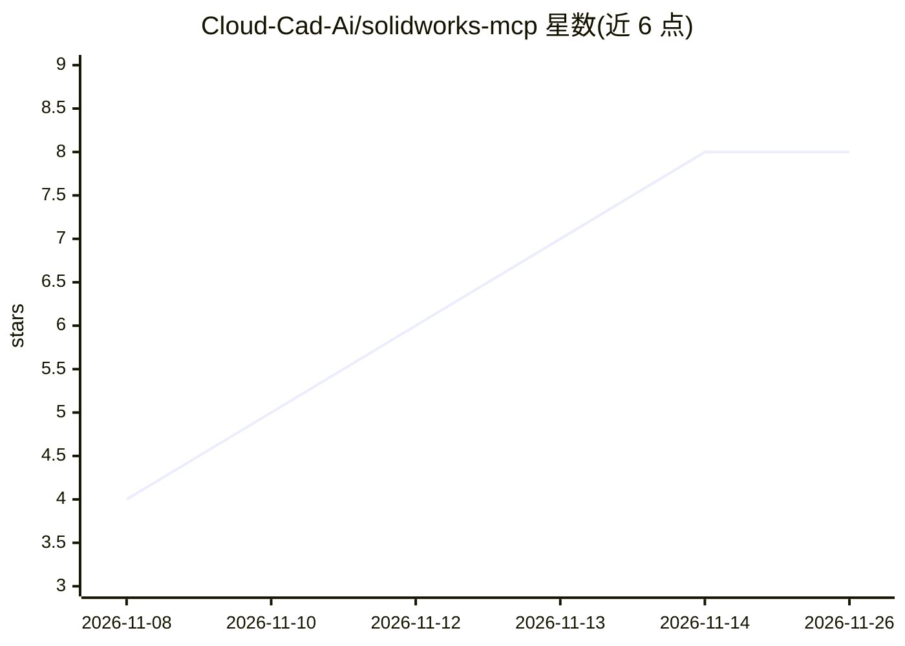

# Cloud-Cad-Ai/solidworks-mcp

⭐ 8 · Python · NOASSERTION · 推送 2026-11-20 · [GitHub](https://github.com/Cloud-Cad-Ai/solidworks-mcp) · [官网](https://www.cloudcadai.com/product/solidworks-mcp/) · 组织维护

**让 Claude/Cursor/Codex 用自然语言操控 SolidWorks 的本地 MCP 服务器**

本地运行的 MCP 服务器，把 Claude Desktop、Cursor、Codex、Claude Code 等客户端连接到同一 Windows PC 上打开的 SolidWorks 会话。支持建模（草图、拉伸、孔、钣金等）、检查（质量属性、干涉、BOM、特征错误）、导出（PDF/DXF/STEP）及 API 签名查询。写入策略支持 trusted/approve/read-only 三档，工具清单与调用次数可在 appsettings.json 配置；仓库发布安装包与伴随技能，服务端源码不开源，提供免费试用与付费计划。

## 筛选速览

| 维度 | 判定 | 备注 |
|---|---|---|
| AI 角色 | `ai-ecosystem` | LLM/agent 周边工具 |
| 许可风险 | `none` | NOASSERTION |
| 部署形态 | `desktop` | 安装包/桌面程序 |
| 模型依赖 | locked-api |  |
| 硬件要求 | — | 无带数字的原话,不猜 |
| 安装摩擦 | `low` | 无编译、无系统依赖或容器化 |
| 成熟度 | — | 结构信号不足 |

## 能力要点

- 支持建模、检查、导出三类任务，配合伴随技能引导客户端调用
- 写入策略三档（trusted/approve/read-only），写操作可要求 Yes/No 确认
- appsettings.json 配置工具清单（full/modeling）与工具调用上限
- 安装器自动注册到 Claude Desktop、Cursor、Codex 的配置文件

## 适用场景

- 用自然语言对打开的零件做建模并读取质量属性
- 装配体 BOM 提取与干涉检查
- 将工程图导出为 PDF/DXF、写入 STEP 文件
- 调用前查询 SolidWorks API 成员签名

## 场景标签

 · 领域:工程/制造-CAD 自动化

## 证据(README 行号)

> L9: SolidWorks MCP is a local MCP server. Your assistant starts one process, named `solidworks`, and talks to the open s
> L11: This repository publishes the installer, release notes, and companion skills. The server source stays with Cad Work
> L43: ChatGPT Work calls remote MCP. Use Codex on the PC where SolidWorks is open. Client questions are in FAQ.md.

## 星数曲线

2026-11-08 4 → 2026-11-26 8（+4）

---
*卡片 v1 · prompt 1.4 · 生成 2026-11-20 · 置信度 high · 依据 README sha `646e119d84f6` · [字段定义](../../DATASET.md)*
