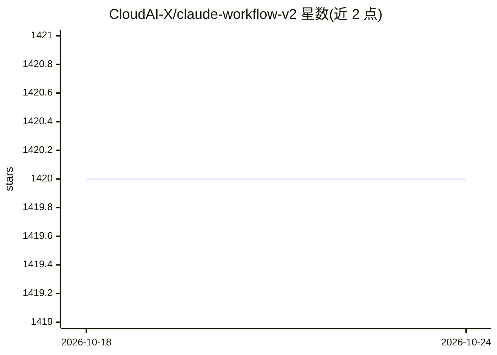

# CloudAI-X/claude-workflow-v2

⭐ 1,420 · Python · MIT · 推送 2026-10-06 · [GitHub](https://github.com/CloudAI-X/claude-workflow-v2) · 组织维护

**通用 Claude Code 工作流插件：7 个子代理+26 命令+14 技能+14 钩子**

面向软件开发者的 Claude Code 工作流插件，将组件复制到 .claude/ 目录并注册钩子：7 个专用子代理（编排、代码审查、调试、安全审计等）按任务自动触发，26 个斜杠命令覆盖 git 内循环、验证、规划与重构，14 个技能域按需加载架构/性能/安全等领域知识，14 个钩子在编辑、会话等事件自动执行安全拦截、格式化与通知。兼容 skills.sh，可分发到 Cursor、Codex 等 35+ AI agent。提供 npx、CLI、SDK 与插件市场四种安装方式。

## 筛选速览

| 维度 | 判定 | 备注 |
|---|---|---|
| AI 角色 | `ai-ecosystem` | LLM/agent 周边工具 |
| 许可风险 | `permissive` | MIT |
| 部署形态 | `library` | 以包/库形式分发 |
| 模型依赖 | locked-api |  |
| 硬件要求 | — | 无带数字的原话,不猜 |
| 安装摩擦 | `low` | 无编译、无系统依赖或容器化 |
| 成熟度 | — | 结构信号不足 |

## 能力要点

- 7 个专用子代理按任务自动触发（编排/审查/调试/安全等）
- 26 个斜杠命令覆盖 git 工作流、多代理验证与规划
- 14 个事件钩子：安全拦截、自动格式化、TypeScript 检查、桌面通知
- 兼容 skills.sh，可安装到 35+ AI agent

## 适用场景

- 在 Claude Code 中自动化提交、推送与创建 PR 的内循环
- 用多子代理对变更做对抗式验证与代码审查
- 通过钩子拦截密钥写入与危险编辑

## 场景标签

`工作流自动化` `代码审查` `编码 Agent` · 领域:效率与自动化

## 证据(README 行号)

> L7: A universal Claude Code workflow plugin with specialized agents, skills, hooks, and mode commands for any software p
> L25: Copies agents, commands, skills and hook scripts into `.claude/` and registers the hooks in `.claude/settings.json`
> L74: ## What's Included

## 星数曲线

2026-10-18 1,420 → 2026-10-24 1,420（+0）

---
*卡片 v1 · prompt 1.4 · 生成 2026-10-21 · 置信度 high · 依据 README sha `f9426281866a` · [字段定义](../../DATASET.md)*
