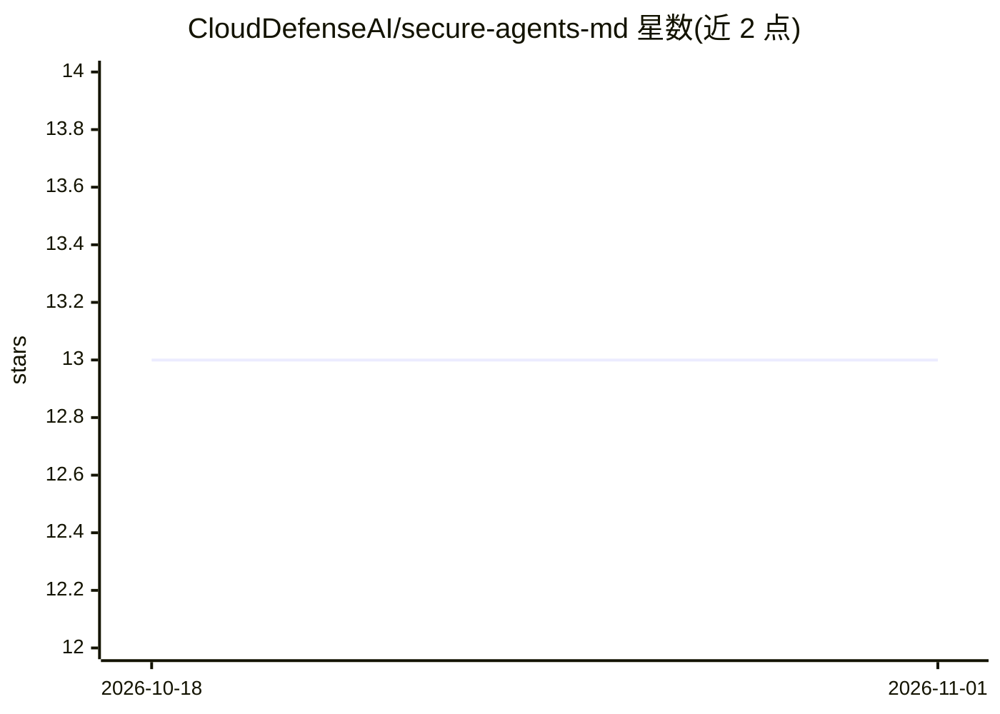

# CloudDefenseAI/secure-agents-md

⭐ 13 · MIT · 推送 2026-05-19 · [GitHub](https://github.com/CloudDefenseAI/secure-agents-md) · 组织维护

**给 AI 编码代理的安全工作协议模板：加固版 AGENTS.md**

由 CloudDefense.AI 与社区维护的安全优先 AGENTS.md 模板仓库：提供可直接复制的加固基线 AGENTS.md、面向敏感目录的 AGENTS.override.md 分层覆盖机制、威胁建模文档与安全编码清单模板，约束编码代理与开发者的行为以减少密钥泄露、提示/工具注入、供应链污染与危险依赖变更等问题。另附带 SECURITY.md、OpenSSF Scorecard workflow、Dependabot 等 OSS 治理默认配置，可经 GitHub 模板或手工复制使用，工具无关。

## 筛选速览

| 维度 | 判定 | 备注 |
|---|---|---|
| AI 角色 | `ai-ecosystem` | LLM/agent 周边工具 |
| 许可风险 | `permissive` | MIT |
| 部署形态 | `None` |  |
| 模型依赖 | — | README 未给出锁定关系 |
| 硬件要求 | — | 无带数字的原话,不猜 |
| 安装摩擦 | `low` | 无编译、无系统依赖或容器化 |
| 成熟度 | — | 结构信号不足 |

## 能力要点

- 加固版 AGENTS.md 基线，直接复制进任意仓库
- AGENTS.override.md 按目录分层覆盖，就近优先
- 威胁建模模板与合并前安全编码清单
- 附带 Scorecard workflow、Dependabot、PR/Issue 安全模板

## 适用场景

- 在我的仓库里为编码代理设置安全护栏
- 为组织多仓库定制统一的安全策略模板
- 让开源项目具备默认的漏洞报告与依赖治理配置

## 场景标签

`网络安全` `提示工程` · 领域:Agent 开发

## 证据(README 行号)

> L3: A security-first **AGENTS.md template** you can drop into any repository so **coding agents** (and developers) follo
> L99: - Stay tool-agnostic while supporting modern agent instruction discovery

## 星数曲线

2026-10-18 13 → 2026-11-01 13（+0）

---
*卡片 v1 · prompt 1.4 · 生成 2026-10-31 · 置信度 high · 依据 README sha `83a07f4c26af` · [字段定义](../../DATASET.md)*
