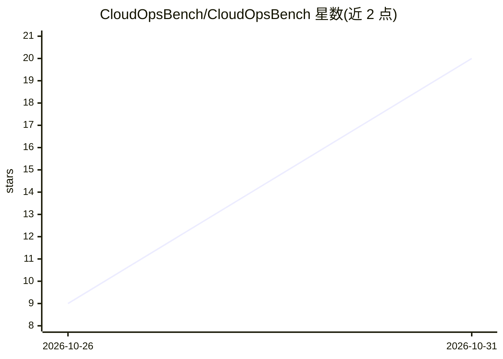

# CloudOpsBench/CloudOpsBench

⭐ 20 · Shell · Apache-2.0 · 推送 2026-10-30 · [GitHub](https://github.com/CloudOpsBench/CloudOpsBench) · [官网](https://cloudopsbench.ai) · 组织维护

**评测 AI agent 云运维能力的开源任务基准套件（45 个 AWS 任务）**

面向 AI agent 评测的开源云基础设施运维任务套件：45 个任务覆盖下线退役、数据迁移、配置变更与故障修复，每任务定义初始云状态、目标、grader 与参考解，采用统一的任务契约，同一任务定义可跨执行后端使用。任务通过 runner 渲染、setup、agent 执行后由不变 grader 判分。当前执行依赖私有的 CloudOpsBenchRunner（经 Harbor 0.21.0 对私有 AWS 模拟器）；仅克隆仓库不含执行后端，42 个任务尚未经 oracle 与阴性对照运行验证。

## 筛选速览

| 维度 | 判定 | 备注 |
|---|---|---|
| AI 角色 | `ai-ecosystem` | LLM/agent 周边工具 |
| 许可风险 | `permissive` | Apache-2.0 |
| 部署形态 | `None` |  |
| 模型依赖 | — | README 未给出锁定关系 |
| 硬件要求 | — | 无带数字的原话,不猜 |
| 安装摩擦 | `low` | 无编译、无系统依赖或容器化 |
| 成熟度 | `idea` | |

## 能力要点

- 45 个真实云运维任务，每任务含 setup、grader 与参考解
- 统一任务定义跨执行后端，不为模拟器重写测试
- 二值判分：grader 通过得 1，失败得 0，执行错误无有效奖励
- 3 个任务使用 Terraform，要求平台提供离线 provider mirror

## 适用场景

- 评测 AI agent 在 AWS 运维任务上的完成率
- 对比不同 agent 框架在云故障修复与退役清理场景的表现
- 作为云运维 agent 研究的标准化测试集

## 场景标签

`模型评测` · 领域:评测与运维

## 证据(README 行号)

> L3: An open-source task suite for evaluating AI agents on cloud infrastructure operations.
> L89: Canonical task → runner rendering → setup → agent → unchanged grader → reward

## 星数曲线

2026-10-26 9 → 2026-10-31 20（+11）

---
*卡片 v1 · prompt 1.4 · 生成 2026-10-30 · 置信度 high · 依据 README sha `f99d0bf1ad70` · [字段定义](../../DATASET.md)*
