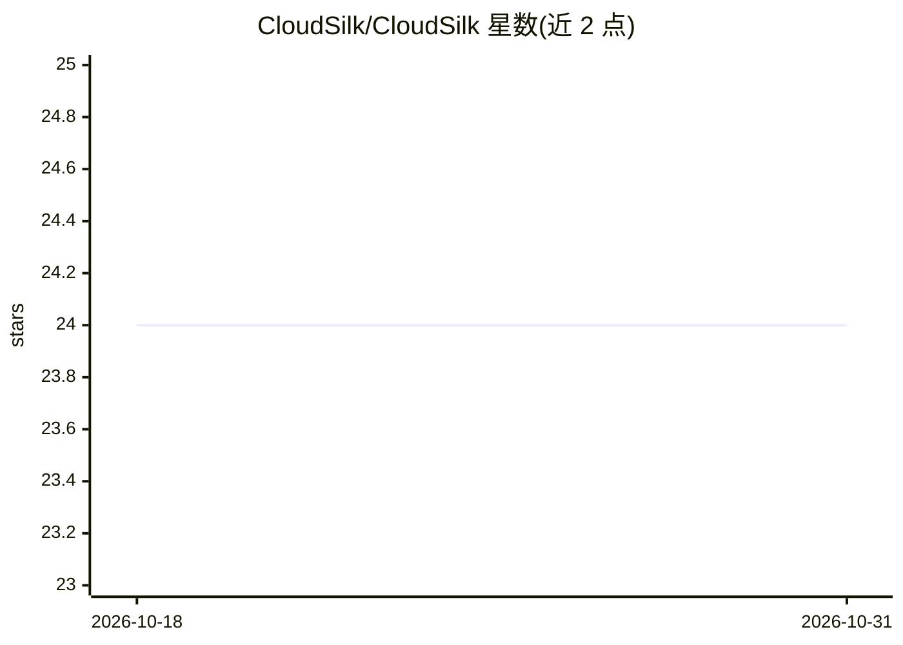

# CloudSilk/CloudSilk

⭐ 24 · Go · Apache-2.0 · 推送 2026-08-15 · [GitHub](https://github.com/CloudSilk/CloudSilk) · [官网](http://101.132.37.232:50015/) · 组织维护 · 中文 README

**开源工厂制造运营管理（MOM）系统，连接 ERP 与产线执行**

位于企业层（ERP）与车间控制层（SCADA/PLC）之间的制造运营管理系统，后端 Golang（Gin/GORM，MySQL/SQLite，可选 dubbo-go+Nacos 微服务模式），前端 React+AntD，业务页面由低代码元数据引擎动态渲染。已维护模块含 MES 生产执行、MSS 物料/仓储、标签打印（C# BarTender 服务）、追溯与低代码平台；质量管理、APS 排程、SCADA 网关、设备管理为规划中。支持多租户与 RBAC，提供 Docker 构建/运行方式。

## 筛选速览

| 维度 | 判定 | 备注 |
|---|---|---|
| AI 角色 | `ai-enhanced` | 去掉 AI 部分产品仍成立 |
| 许可风险 | `permissive` | Apache-2.0 |
| 部署形态 | `self-host` | docker 或自建部署 |
| 模型依赖 | — | README 未给出锁定关系 |
| 硬件要求 | — | 无带数字的原话,不猜 |
| 安装摩擦 | `low` | 无编译、无系统依赖或容器化 |
| 成熟度 | — | 结构信号不足 |

## 能力要点

- MES 生产执行：工单、工艺路线、进/出站、报工、返工、工位节拍
- 低代码平台：CRUD 元数据引擎、动态表单/页面、BPM 设计器
- C# BarTender 标签打印服务，MQTT 任务分发
- usercenter 用户中心：认证、RBAC、多租户

## 适用场景

- 工厂管理层实时掌握生产进度、设备与质量状况
- 把 ERP 订单与产线实际执行对接起来
- 通过低代码平台快速搭建和调整业务表单与流程
- 管理仓库、AGV 任务与物料追溯

## 场景标签

`工作流自动化` · 领域:效率与自动化

## 证据(README 行号)

> L11: **CloudSilk** (云梭) is an open-source **MOM (Manufacturing Operations Management)** system — the "smart hub" of a fa
> L13: It sits between the enterprise layer (ERP) and the shop-floor control layer (SCADA/PLC), connecting business orders
> L105: - **正在维护的模块**：MES 生产执行、MSS 物料/仓储、标签打印、追溯、低代码平台（配合 usercenter 用户中心）

## 星数曲线

2026-10-18 24 → 2026-10-31 24（+0）

---
*卡片 v1 · prompt 1.4 · 生成 2026-10-27 · 置信度 low · 依据 README sha `bee0aa0f1134` · [字段定义](../../DATASET.md)*
