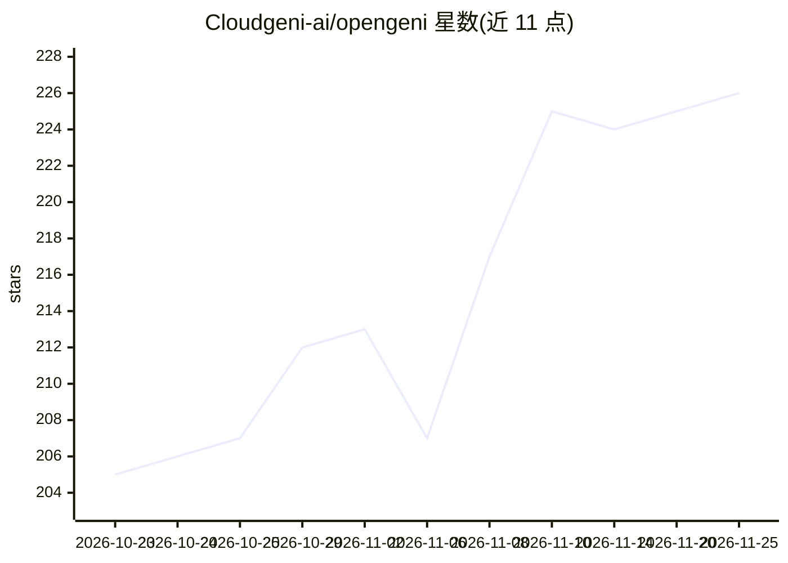

# Cloudgeni-ai/opengeni

⭐ 226 · TypeScript · Apache-2.0 · 推送 2026-11-24 · [GitHub](https://github.com/Cloudgeni-ai/opengeni) · [官网](https://opengeni.ai/) · 组织维护

**团队自托管的 agent 运行时：可审批、可审计地跑真实工作**

Opengeni 是一个自托管的多用户 agent 服务：每个团队/客户一个 workspace，agent 在 Slack、桌面端或 Web 中执行会议跟进、报告、PR 审查等任务，工具调用需人工审批，凭证存于加密 vault、模型不可见。会话基于 Postgres 与 Temporal 做持久化与精确重放，支持定时与事件触发、子 agent 分工、按 workspace 的预算控制。模型可自选（OpenAI/Azure/Anthropic/OpenRouter 或 OpenAI 兼容服务），部署提供 Helm chart 与 Terraform 参考配置，另有官方托管版。

## 筛选速览

| 维度 | 判定 | 备注 |
|---|---|---|
| AI 角色 | `ai-ecosystem` | LLM/agent 周边工具 |
| 许可风险 | `permissive` | Apache-2.0 |
| 部署形态 | `desktop` | 安装包/桌面程序 |
| 模型依赖 | — | README 未给出锁定关系 |
| 硬件要求 | — | 无带数字的原话,不猜 |
| 安装摩擦 | `medium` | 含编译或系统依赖之一 |
| 成熟度 | — | 结构信号不足 |

## 能力要点

- 每个工具调用支持 Allow/Ask/Block 三级人工审批
- 会话事件、审批与工具调用存入 Postgres 并可精确重放审计
- API、Web、桌面端、Helm chart、Terraform 全部 Apache-2.0
- 接入 OpenAI/Azure/Anthropic/OpenRouter 或任意 OpenAI 兼容服务，可强制仅 EU 推理

## 适用场景

- 团队共享的 agent 工作台，敏感操作先经人工批准
- 在自有 Kubernetes 与区域内部署，数据不出自有 Postgres
- 把 agent 会话以 SDK 嵌入自家产品给每个客户使用
- 定时或在 GitHub/Sentry/webhook 事件触发时自动跑任务

## 场景标签

`Agent 框架` `多智能体` · 领域:Agent 开发

## 证据(README 行号)

> L7:  The open-source agent harness your team runs on its own infrastructure.
> L24: Opengeni is the harness around the agent, and you run all of it. One deployment on your own Kubernetes, in the regi
> L43: - **Bring your own models.** OpenAI, Azure OpenAI, Anthropic Claude, OpenRouter, or any OpenAI-compatible server, s

## 星数曲线

2026-10-23 205 → 2026-11-25 226（+21）

---
*卡片 v1 · prompt 1.4 · 生成 2026-11-25 · 置信度 high · 依据 README sha `5001a188f3a8` · [字段定义](../../DATASET.md)*
