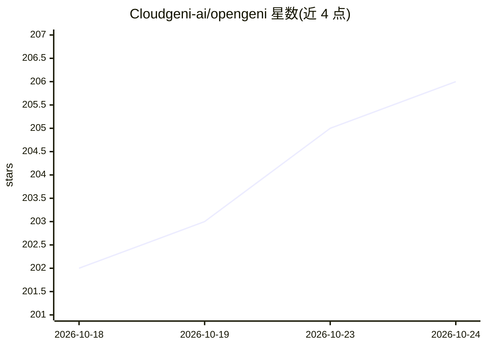

# Cloudgeni-ai/opengeni

⭐ 207 · TypeScript · Apache-2.0 · 推送 2026-10-24 · [GitHub](https://github.com/Cloudgeni-ai/opengeni) · [官网](https://opengeni.ai/) · 组织维护

**面向组织的可自托管 agentic 服务：持久会话与人工审批**

自托管/托管双形态的 agent 运行服务：运行执行实际工作的 AI agent，会话可持续数小时或数天，每个事件落入 Postgres 形成可重放日志，危险工具调用前暂停等待人工审批，可在 Docker/Modal/云沙箱或自有机器（Connected Machine，仅外拨）上执行。提供 Web 控制台、Slack/语音/SDK/API 等多种接入面、React 嵌入组件、macOS/Windows/Linux 桌面端，以及 Helm chart 与 Azure/AWS/GCP Terraform 参考部署。本地开发需 Bun、Docker、rustup、C 编译器与 OpenAI 或 Azure OpenAI key。

## 筛选速览

| 维度 | 判定 | 备注 |
|---|---|---|
| AI 角色 | `ai-ecosystem` | LLM/agent 周边工具 |
| 许可风险 | `permissive` | Apache-2.0 |
| 部署形态 | `desktop` | 安装包/桌面程序 |
| 模型依赖 | locked-api |  |
| 硬件要求 | — | 无带数字的原话,不猜 |
| 安装摩擦 | `medium` | 含编译或系统依赖之一 |
| 成熟度 | — | 结构信号不足 |

## 能力要点

- 事件全部落入 Postgres 的持久可重放会话与审计历史
- 工具调用前的人工审批门控，答案后精确恢复执行（跨重启）
- 托管沙箱或自有机器（Connected Machine，仅外拨连接）执行
- React 嵌入组件与租户级代理路由，API key 留在服务端

## 适用场景

- 让 agent 长时间执行运维/基础设施任务并可审计回放
- 在自己的产品里嵌入带审批的 agent 会话界面
- 把 agent 会话跑在自己的笔记本、构建机或 GPU 机器上

## 场景标签

`Agent 框架` · 领域:Agent 开发

## 证据(README 行号)

> L22: Opengeni is a production-ready agentic service: it runs AI agents that do real work, keeps a session going for hour
> L24: Opengeni is not the agent; it is everything the agent needs around it. Give agents work from the web app and follow
> L40: - **Managed or self-hosted.** Use app.opengeni.ai with nothing to run, or deploy the same API, web app, workers, He

## 星数曲线

2026-10-18 202 → 2026-10-24 206（+4）

---
*卡片 v1 · prompt 1.4 · 生成 2026-10-22 · 置信度 high · 依据 README sha `b420212819a0` · [字段定义](../../DATASET.md)*
