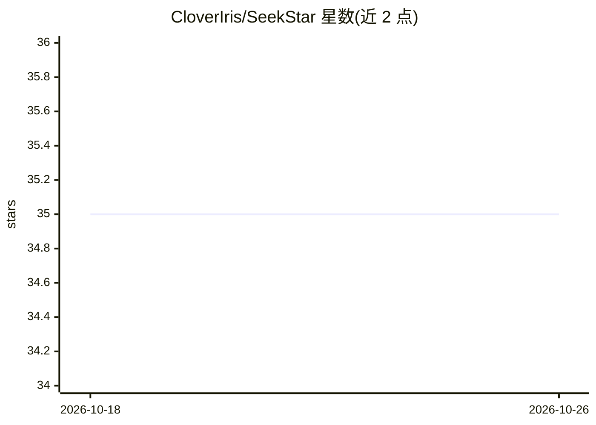

# CloverIris/SeekStar

⭐ 35 · TypeScript · MIT · 推送 2026-07-19 · [GitHub](https://github.com/CloverIris/SeekStar) · [官网](https://SeekStar.AI) · 个人维护 · 中文 README

**AI 认知星图桌面应用：以空间化探索帮用户发现未知问题**

基于 Electron + React + PixiJS 的桌面应用，将检索重构为 2.5D 认知星图：用户从词、网页或圈选区域进入语义场，通过缩放、漫游在领域层、主题层、来源层、Tile 场与 Deep Lens 文本粒度间切换。AI Cartographer 负责生成认知结构、解释区域与候选来源，Playwright Scout 负责抓取真实网页快照并验证候选，AI 生成内容须与真实来源区分并标记雾区。目前处于 MVP 开发阶段，AI 接入通过 DeepSeek OpenAI 兼容接口。

## 筛选速览

| 维度 | 判定 | 备注 |
|---|---|---|
| AI 角色 | `ai-native` | 本体是模型或模型工具 |
| 许可风险 | `permissive` | MIT |
| 部署形态 | `library` | 以包/库形式分发 |
| 模型依赖 | locked-api |  |
| 硬件要求 | — | 无带数字的原话,不猜 |
| 安装摩擦 | `low` | 无编译、无系统依赖或容器化 |
| 成熟度 | `idea` | |

## 能力要点

- AI Cartographer 生成分层认知地形并标记不确定雾区
- Playwright Scout 抓取网页快照，候选经验证才进入 source-backed Tile Field
- 任意文本粒度（段落/词/字符）可递归成为新探索 seed
- AI 输出须经 schema 校验的结构化结果

## 适用场景

- 在不知道该问什么时，通过空间探索发现值得追问的问题
- 围绕一个主题漫游语义星图，理解领域结构与相邻概念
- 对圈选区域请求 AI 解释并导出为结构化 Markdown

## 场景标签

`语义搜索` `网页抓取` · 领域:效率与自动化

## 证据(README 行号)

> L4: > SeekStar 是一个用于探索「未知的未知」的 AI 认知星图。
> L321: **SeekStar 是一个 AI 驱动的认知制图工具，用空间化、可缩放、可圈选、可解释的方式，帮助用户发现自己尚未意识到的问题。**
> L175: |AI Agent|制图师 Cartographer|生成认知结构、解释区域、规划探索|

## 星数曲线

2026-10-18 35 → 2026-10-26 35（+0）

---
*卡片 v1 · prompt 1.4 · 生成 2026-10-25 · 置信度 mid · 依据 README sha `9b151e867d83` · [字段定义](../../DATASET.md)*
