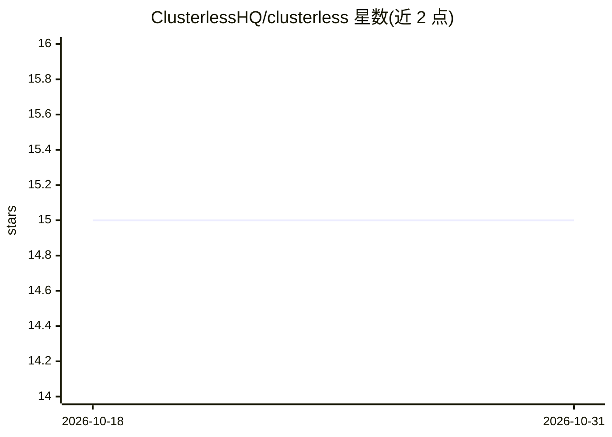

# ClusterlessHQ/clusterless

⭐ 15 · Java · NOASSERTION · 推送 2026-09-27 · [GitHub](https://github.com/ClusterlessHQ/clusterless) · 组织维护

**跨云部署事件驱动数据处理管线的 CLI 工具**

Clusterless 是一个去中心化、可扩展的数据管道部署工具，面向持续到达的数据，利用云原生按需付费原语（当前仅支持 AWS），无需管理运行时或专用服务。工作负载可通过事件链式衔接，支持回填、重放、缺口检查、启停、版本化与本地测试；负载可实现为 Docker 镜像、Serverless 函数或原生服务（SageMaker/Athena/Glue），可执行训练验证等操作。以 cls CLI 提供，Gradle 从源码构建，项目处于活跃开发中，部分 API 为实验性。

## 筛选速览

| 维度 | 判定 | 备注 |
|---|---|---|
| AI 角色 | `ai-ecosystem` | LLM/agent 周边工具 |
| 许可风险 | `none` | NOASSERTION |
| 部署形态 | `None` |  |
| 模型依赖 | — | README 未给出锁定关系 |
| 硬件要求 | — | 无带数字的原话,不猜 |
| 安装摩擦 | `medium` | 含编译或系统依赖之一 |
| 成熟度 | `idea` | |

## 能力要点

- 事件驱动链接异构工作负载，支持回填/重放/缺口检查/版本化
- 工作负载可为 Docker 镜像、Serverless 函数或 AWS 原生服务
- 无数据到达时零成本（除历史数据存储）
- 支持本地与全管线场景测试

## 适用场景

- 在 AWS 上部署持续到达数据的处理管道
- 对历史数据回填新版本工作负载或重放修正
- 链式编排数据重格式化、重分区、特征提取与训练任务

## 场景标签

`MLOps` `工作流自动化` · 领域:效率与自动化

## 证据(README 行号)

> L31: Clusterless is a tool for deploying decentralized, scalable, and secure data-processing workloads for continuously
> L56: - execute training and validation (via custom Python or simply calling SageMaker)

## 星数曲线

2026-10-18 15 → 2026-10-31 15（+0）

---
*卡片 v1 · prompt 1.4 · 生成 2026-10-31 · 置信度 mid · 依据 README sha `9f0161b5a785` · [字段定义](../../DATASET.md)*
