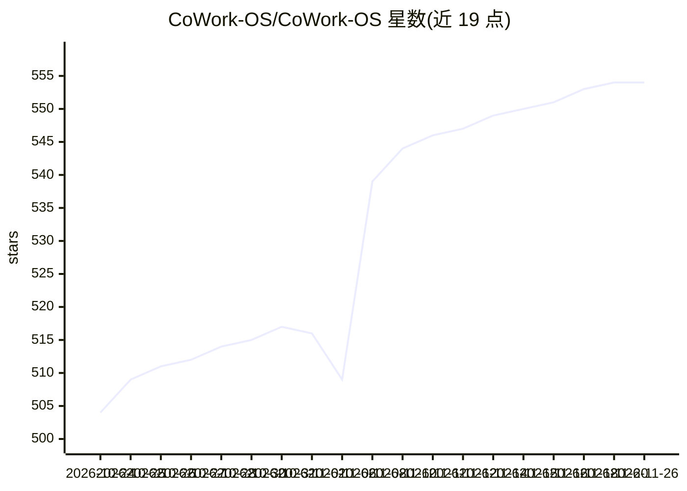

# CoWork-OS/CoWork-OS

⭐ 554 · TypeScript · MIT · 推送 2026-11-25 · [GitHub](https://github.com/CoWork-OS/CoWork-OS) · [官网](https://coworkosapp.com) · 组织维护 · 中文 README

**开源桌面 AI 代理：可视审批下执行文件/邮件/浏览器任务**

面向 macOS 与 Windows 的开源桌面应用，代理可操作本地文件、生成文档/表格、浏览网页、处理收件箱并运行定时机器人；时间线展示每步操作，访问配置（Ask for approval 等）决定哪些步骤需人工批准，并有硬性限制。工作区、记忆（本地 git 文件夹中的 markdown）、技能与历史保留在本地。模型可选 OpenRouter 免登录、ChatGPT 登录、本地 Ollama/LM Studio 或 API key，按会话切换；另提供 cowork CLI 与 Linux 无头服务器。安装包未经 Apple 公证/Windows 代码签名。

## 筛选速览

| 维度 | 判定 | 备注 |
|---|---|---|
| AI 角色 | `ai-native` | 本体是模型或模型工具 |
| 许可风险 | `permissive` | MIT |
| 部署形态 | `library` | 以包/库形式分发 |
| 模型依赖 | local-ok | 支持本地模型 |
| 硬件要求 | — | 无带数字的原话,不猜 |
| 安装摩擦 | `low` | 无编译、无系统依赖或容器化 |
| 成熟度 | — | 结构信号不足 |

## 能力要点

- 时间线逐步可视，访问配置与硬性限制控制风险操作
- 本地优先：工作区、记忆、技能与历史留在本机
- 多模型接入：OpenRouter、ChatGPT 登录、本地 Ollama/LM Studio、API key
- 支持从 Hermes Agent / OpenClaw 导入配置，并提供 cowork CLI

## 适用场景

- 批量把文件夹里的发票整理成带汇总的表格
- 在可见浏览器窗口中做调研并拿到带来源的报告
- 定时机器人向 Telegram/Slack/Discord 发送晨报
- 起草邮件回复但发送前必须人工批准

## 场景标签

`AI 助手` · 领域:对话与助手

## 证据(README 行号)

> L17: CoWork OS is a free, open-source desktop app for macOS and Windows that does real work for you: files, documents, t
> L43: |**See every step, approve the risky ones**|The timeline shows each file read, command and edit as it happens. Acce
> L49: |**Any model you choose, switch any time**|OpenRouter sign-in with free models, ChatGPT sign-in, local Ollama or LM

## 星数曲线

2026-10-24 504 → 2026-11-26 554（+50）

---
*卡片 v1 · prompt 1.4 · 生成 2026-11-25 · 置信度 high · 依据 README sha `b277fcc7601d` · [字段定义](../../DATASET.md)*
