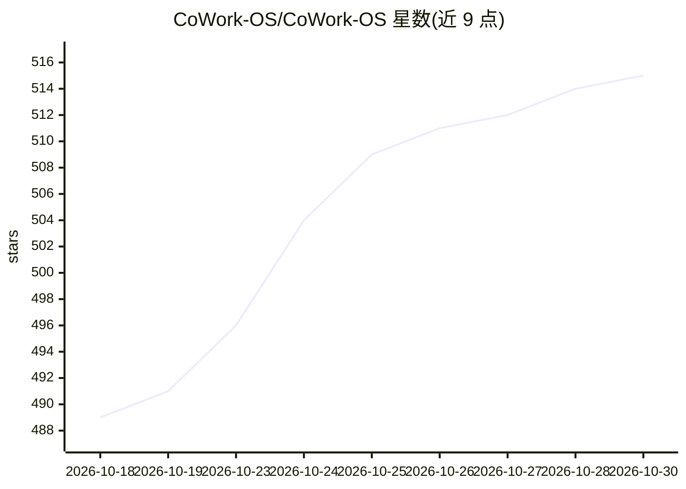

# CoWork-OS/CoWork-OS

⭐ 515 · TypeScript · MIT · 推送 2026-10-29 · [GitHub](https://github.com/CoWork-OS/CoWork-OS) · [官网](https://coworkosapp.com) · 组织维护 · 中文 README

**给个人用户的可视化审批 AI 桌面代理：处理文件/收件箱/浏览器/定时任务**

macOS/Windows 桌面应用（Electron），AI agent 替用户完成实际工作：生成可编辑的文档/表格、收件箱分类与草稿、可见浏览器研究、定时机器人推送至 Telegram/Slack/Discord、代码终端操作。关键机制是逐步时间线与访问配置（Ask for approval/Approve for me/Full access/Custom），离开工作区的操作需批准；记忆以本地 git 文件夹中的 markdown 保存。模型可选：OpenRouter 登录（免费模型）、ChatGPT 登录、本地 Ollama/LM Studio 或 API key。支持从 Hermes/OpenClaw 导入配置；提供 npm 安装与 CLI，Linux 走 headless 服务器。

## 筛选速览

| 维度 | 判定 | 备注 |
|---|---|---|
| AI 角色 | `ai-native` | 本体是模型或模型工具 |
| 许可风险 | `permissive` | MIT |
| 部署形态 | `library` | 以包/库形式分发 |
| 模型依赖 | local-ok | 支持本地模型 |
| 硬件要求 | — | 无带数字的原话,不猜 |
| 安装摩擦 | `low` | 无编译、无系统依赖或容器化 |
| 成熟度 | — | 结构信号不足 |

## 能力要点

- 时间线展示每步操作，访问配置控制需批准的风险操作
- 产出可编辑文件（文档/表格/PDF）在对话旁打开
- 记忆以本地 markdown + git 文件夹保存，可读可改可删
- 支持 OpenRouter/ChatGPT 登录与本地 Ollama/LM Studio 模型，可按对话切换

## 适用场景

- 让 AI 整理发票文件夹并生成带汇总的表格
- AI 分类和起草邮件回复，发送前需我批准
- 定时机器人生成晨报推送到 Telegram/Slack/Discord
- 在可见浏览器中做资料研究并附来源

## 场景标签

`AI 助手` `浏览器自动化` `AI 写作` · 领域:效率与自动化

## 证据(README 行号)

> L16: CoWork OS is a free, open-source desktop app for macOS and Windows that does real work for you: files, documents, t
> L24: - **Turn a folder of files into finished work.** "Make a spreadsheet of these invoices with a total per vendor" — t
> L30: - **Keep it all local if you want.** Run on Ollama or LM Studio on your own machine, or sign in with OpenRouter and

## 星数曲线

2026-10-18 489 → 2026-10-30 515（+26）

---
*卡片 v1 · prompt 1.4 · 生成 2026-10-22 · 置信度 high · 依据 README sha `43f5c78397bb` · [字段定义](../../DATASET.md)*
