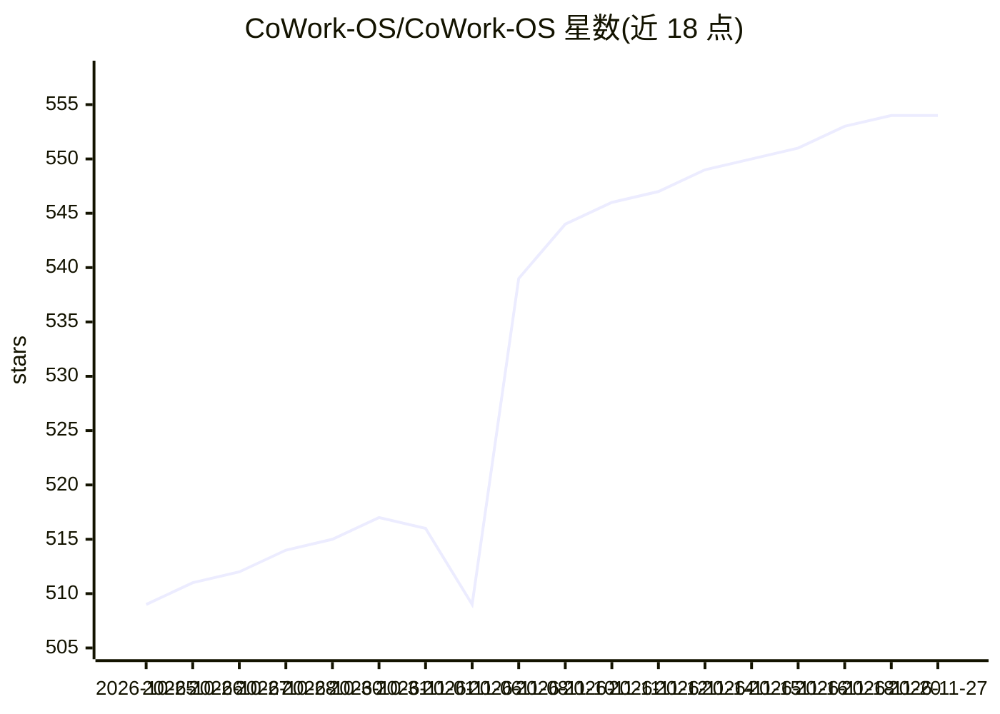

# CoWork-OS/CoWork-OS

⭐ 554 · TypeScript · MIT · 推送 2026-11-26 · [GitHub](https://github.com/CoWork-OS/CoWork-OS) · [官网](https://coworkosapp.com) · 组织维护 · 中文 README

**开源 AI agent 桌面应用：可见可审批地代你干活**

CoWork OS 是运行于 macOS 与 Windows 的本地优先开源 AI agent 桌面应用，覆盖文件、文档、浏览器、收件箱与定时任务等场景。用户自带 API key 或登录接入多家模型服务商，也可经 Ollama/LM Studio 运行本地模型。核心机制是时间线上逐步展示每个动作，默认 Ask for approval 配置下工作区内的操作自主执行，涉及发送、联网、凭证或工作区外文件的步骤须人工审批；记忆以本地 git 文件夹中的 markdown 存储。许可证为 MIT，提供 CLI 与 Linux 无头服务器。

## 筛选速览

| 维度 | 判定 | 备注 |
|---|---|---|
| AI 角色 | `ai-native` | 本体是模型或模型工具 |
| 许可风险 | `permissive` | MIT |
| 部署形态 | `library` | 以包/库形式分发 |
| 模型依赖 | local-ok | 支持本地模型 |
| 硬件要求 | — | 无带数字的原话,不猜 |
| 安装摩擦 | `low` | 无编译、无系统依赖或容器化 |
| 成熟度 | — | 结构信号不足 |

## 能力要点

- 时间线展示每步动作，四种访问配置加硬限制控制审批范围
- 支持 OpenRouter 登录、ChatGPT 登录、本地 Ollama/LM Studio 或 API key 多路接入
- 文档/表格/网页/PDF 在聊天旁打开并可继续修改
- 可从 Hermes Agent 或 OpenClaw 导入人设、记忆、技能与机器人配置

## 适用场景

- 把一堆发票整理成带汇总的表格等文件型工作
- 收件箱自动分类、摘要并起草回复，发送前人工确认
- 定时让机器人向 Telegram/Slack/Discord 推送晨报
- 全程可见地让 agent 操作浏览器做调研

## 场景标签

`AI 助手` `浏览器自动化` `工作流自动化` · 领域:效率与自动化

## 证据(README 行号)

> L17: CoWork OS is a free, open-source AI agent desktop app for macOS and Windows that does real work for you: files, doc
> L43: |**See every step, approve the risky ones**|The timeline shows each file read, command and edit as it happens. Acce

## 星数曲线

2026-10-25 509 → 2026-11-27 554（+45）

---
*卡片 v1 · prompt 1.4 · 生成 2026-11-27 · 置信度 high · 依据 README sha `5a861a54267e` · [字段定义](../../DATASET.md)*
