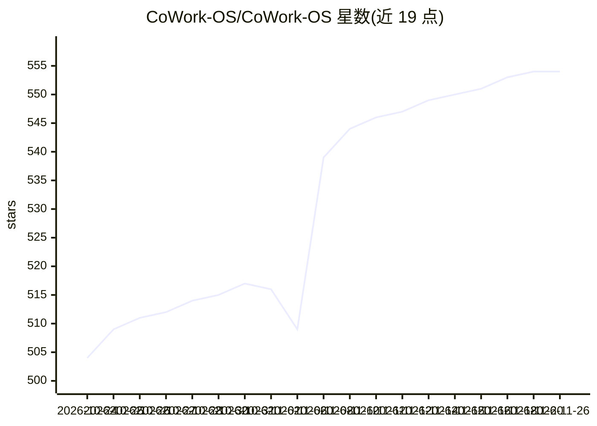

# CoWork-OS/CoWork-OS

⭐ 554 · TypeScript · MIT · 推送 2026-11-25 · [GitHub](https://github.com/CoWork-OS/CoWork-OS) · [官网](https://coworkosapp.com) · 组织维护

**本地优先、操作可视可审批的开源 AI agent 桌面应用**

面向 macOS 与 Windows 的开源 AI agent 桌面应用，可操作文件、文档、浏览器、收件箱和定时任务。默认 Ask for approval 配置下，工作区内的操作自动执行，任何外发、联网、使用凭据或离开工作区的动作都会暂停等待用户批准；时间线逐步展示文件读取、命令与编辑。本地优先，工作区、记忆（本地 git 文件夹中的 markdown）、技能与历史留在本机；通过 API key、OpenRouter 登录、ChatGPT 登录或本地 Ollama/LM Studio 接入模型，并可从 WhatsApp、Telegram、Slack、Discord 收发消息。提供 macOS/Windows 安装脚本、npm 包与 Linux headless 服务器。

## 筛选速览

| 维度 | 判定 | 备注 |
|---|---|---|
| AI 角色 | `ai-native` | 本体是模型或模型工具 |
| 许可风险 | `permissive` | MIT |
| 部署形态 | `library` | 以包/库形式分发 |
| 模型依赖 | local-ok | 支持本地模型 |
| 硬件要求 | — | 无带数字的原话,不猜 |
| 安装摩擦 | `low` | 无编译、无系统依赖或容器化 |
| 成熟度 | — | 结构信号不足 |

## 能力要点

- 每个决策有审批卡片，时间线展示每步文件读取、命令与编辑
- 访问配置文件（Ask for approval/Full access 等）与硬性限额
- 记忆为本地 git 文件夹中的明文 markdown，可读改删
- 支持 Hermes/OpenClaw 配置导入及跨产品迁移

## 适用场景

- 把文件夹里的发票整理成带汇总的电子表格
- AI 分拣收件箱、起草回复，发送前由我审批
- 定时让 bot 向 Telegram/Slack/Discord 发晨报
- 在可视浏览器窗口中让 agent 做调研并核对来源

## 场景标签

`AI 助手` `浏览器自动化` `工作流自动化` · 领域:效率与自动化

## 证据(README 行号)

> L17: CoWork OS is a free, open-source AI agent desktop app for macOS and Windows that does real work for you: files, doc
> L43: |**See every step, approve the risky ones**|The timeline shows each file read, command and edit as it happens. Acce
> L44: |**Get finished files, not just answers**|Documents, spreadsheets, decks, web pages and PDFs open beside the agent,

## 星数曲线

2026-10-24 504 → 2026-11-26 554（+50）

---
*卡片 v1 · prompt 1.4 · 生成 2026-11-26 · 置信度 high · 依据 README sha `a481f0b66bf8` · [字段定义](../../DATASET.md)*
