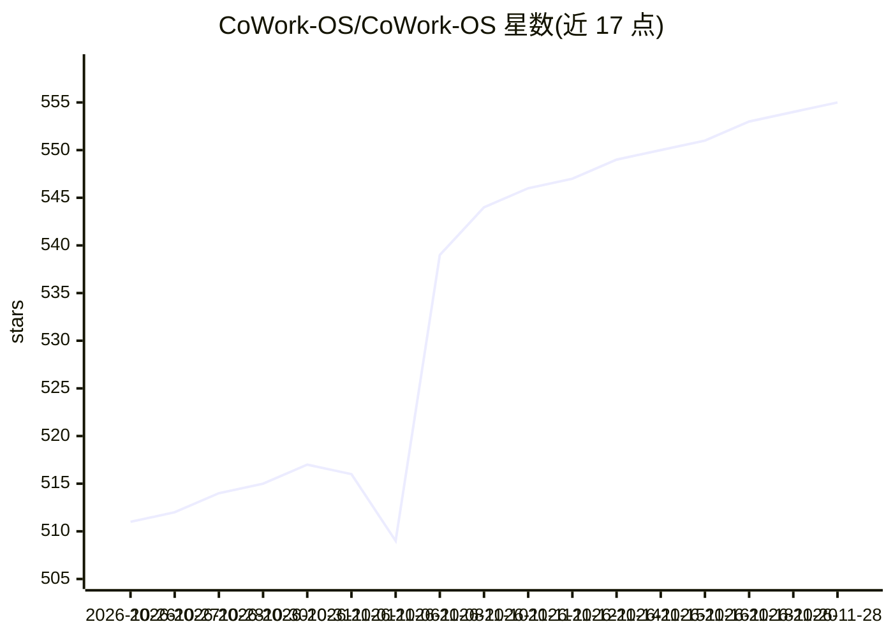

# CoWork-OS/CoWork-OS

⭐ 555 · TypeScript · MIT · 推送 2026-11-27 · [GitHub](https://github.com/CoWork-OS/CoWork-OS) · [官网](https://coworkosapp.com) · 组织维护 · 中文 README

**本地优先的开源 AI agent 桌面应用，可审批执行文件/邮件/浏览器任务**

面向 macOS 与 Windows 的开源 AI agent 桌面应用，可操作文件与文档、浏览网页、处理收件箱并运行定时 bot。核心机制：时间线逐步展示每个文件读取、命令与编辑，访问配置文件（默认 Ask for approval）决定哪些操作需人工批准，越出工作区的发送、联网、凭据使用均先询问。模型接入支持 OpenRouter 免 key 登录、ChatGPT 登录、本地 Ollama/LM Studio 或各家 API key，可按对话切换；工作区、记忆与历史保留在本机，记忆为本地 git 中的 markdown。提供 npm 安装、CLI、Linux headless 服务器与 Hermes/OpenClaw/Claude Code/Cursor 配置导入。

## 筛选速览

| 维度 | 判定 | 备注 |
|---|---|---|
| AI 角色 | `ai-native` | 本体是模型或模型工具 |
| 许可风险 | `permissive` | MIT |
| 部署形态 | `library` | 以包/库形式分发 |
| 模型依赖 | local-ok | 支持本地模型 |
| 硬件要求 | — | 无带数字的原话,不猜 |
| 安装摩擦 | `low` | 无编译、无系统依赖或容器化 |
| 成熟度 | — | 结构信号不足 |

## 能力要点

- 时间线可视化每步操作，访问配置文件与硬性限额控制风险动作
- 多种模型接入：OpenRouter 免 key、ChatGPT 登录、本地 Ollama/LM Studio、各家 API key
- 记忆为本地 git 文件夹中的可编辑 markdown
- 支持从 Hermes Agent、OpenClaw、Claude Code、Cursor 导入配置与技能

## 适用场景

- 让 agent 整理文件夹生成带汇总的电子表格并就地修改
- 邮件分诊、摘要与起草回复，发送前人工批准
- 定时 bot 向 Telegram/Slack/Discord 推送晨报
- 在可见浏览器窗口中做带来源的研究报告

## 场景标签

`AI 助手` `浏览器自动化` · 领域:效率与自动化

## 证据(README 行号)

> L17: CoWork OS is a free, open-source AI agent desktop app for macOS and Windows that does real work for you: files, doc
> L43: |**See every step, approve the risky ones**|The timeline shows each file read, command and edit as it happens. Acce

## 星数曲线

2026-10-26 511 → 2026-11-28 555（+44）

---
*卡片 v1 · prompt 1.4 · 生成 2026-11-28 · 置信度 high · 依据 README sha `cb3e5f08beed` · [字段定义](../../DATASET.md)*
