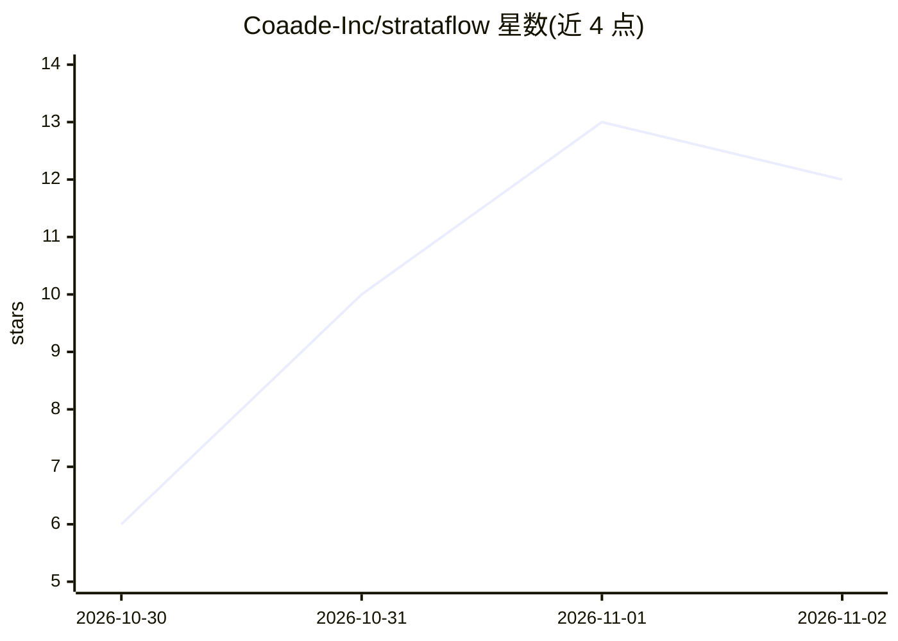

# Coaade-Inc/strataflow

⭐ 12 · C++ · NOASSERTION · 推送 2026-10-16 · [GitHub](https://github.com/Coaade-Inc/strataflow) · [官网](https://www.coaade.com/products/strataflow) · 组织维护

**本地推理引擎：跨 VRAM/RAM/SSD 流式运行超大 MoE 模型**

Coaade Inc. 开发的本地推理引擎，目标是让千亿至万亿参数级 MoE 模型在普通硬件上运行：权重按层分布于 VRAM/RAM/SSD，仅将每 token 激活的 top-k 专家加载进内存，其余留在磁盘按需流式读取，内存大小只影响速度不影响输出。复用 ggml 作为内核与 GGUF 读取器（llama.cpp 仅作分词器与正确性对照，不在前向路径中），自带计算图、调度器、分层权重存储与 .strata 单文件格式。当前 CPU 路径可用（Linux/macOS/Windows CI 绿），已验证 Q8_0 与 Q4_K/Q6_K 量化及真实 Mixtral/TinyLlama 端到端运行；GPU 后端、IQ 量化、更多架构（Qwen2-MoE/DeepSeek-MoE）与 HTTP 服务端未实现。以 CLI 形式提供，无发布标签。

## 筛选速览

| 维度 | 判定 | 备注 |
|---|---|---|
| AI 角色 | `ai-ecosystem` | LLM/agent 周边工具 |
| 许可风险 | `none` | NOASSERTION |
| 部署形态 | `None` |  |
| 模型依赖 | — | README 未给出锁定关系 |
| 硬件要求 | — | 无带数字的原话,不猜 |
| 安装摩擦 | `high` | 编译与系统依赖俱全 |
| 成熟度 | `idea` | |

## 能力要点

- 自建 ggml 前向计算图，每层仅驻留 top-k 激活专家，输出与 oracle 逐字节一致
- 跨 VRAM/RAM/SSD 的分层权重存储与 .strata 流式格式（由 GGUF 打包）
- 按可用 RAM 自动设定专家驻留数，峰值 RSS 不随模型磁盘体积增长
- 预测驱动的异步预取将磁盘读取与计算重叠（默认开启，可关闭）

## 适用场景

- 在低 RAM、无 GPU 的机器上运行万亿参数级 MoE 模型
- 用已有内存跑大模型而不必整体载入显存/内存
- 以受限内存预算（--cache-gb/--expert-slots）运行并监控峰值 RSS

## 场景标签

`推理引擎` · 领域:训练与推理

## 证据(README 行号)

> L5: A local inference engine that streams trillion-scale Mixture-of-Experts models
> L41: - **Its own forward pass over ggml.** StrataFlow builds and runs the compute
> L87: Importantly, **`llama.cpp` is not in the forward pass.** StrataFlow constructs

## 星数曲线

2026-10-30 6 → 2026-11-02 12（+6）

---
*卡片 v1 · prompt 1.4 · 生成 2026-10-31 · 置信度 high · 依据 README sha `256ea9dd653b` · [字段定义](../../DATASET.md)*
