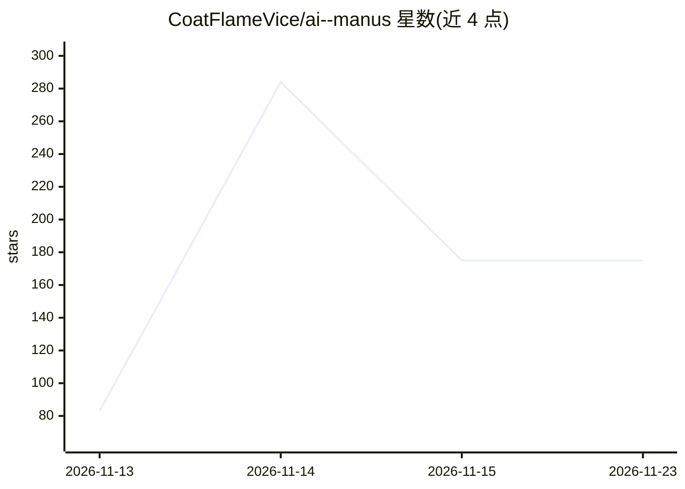

# CoatFlameVice/ai--manus

⭐ 175 · Apache-2.0 · 推送 2026-11-15 · [GitHub](https://github.com/CoatFlameVice/ai--manus) · 个人维护

**面向日常任务的自主 AI Agent：自动执行代码与浏览器操作**

README 描述的 Manus 是一个自主 AI agent，可在用户授权下编写并执行脚本、控制浏览器（导航网页、填写表单、采集信息）、执行多步骤任务。定位为家庭、学习与轻量办公场景的个人助手，而非企业平台。README 标注最低双核 CPU、4 GB 内存即可运行，并给出通用的六步上手流程。但 README 未提供任何具体安装命令、代码仓库内容说明或模型接入方式，仅含下载入口与推广码，实现细节无法核验。

## 筛选速览

| 维度 | 判定 | 备注 |
|---|---|---|
| AI 角色 | `ai-native` | 本体是模型或模型工具 |
| 许可风险 | `permissive` | Apache-2.0 |
| 部署形态 | `None` |  |
| 模型依赖 | — | README 未给出锁定关系 |
| 硬件要求 | — | 无带数字的原话,不猜 |
| 安装摩擦 | `low` | 无编译、无系统依赖或容器化 |
| 成熟度 | — | 结构信号不足 |

## 能力要点

- agent 自主编写并执行脚本完成多步骤任务
- 浏览器控制：导航网页、填表、采集信息
- 定位家庭、学习与轻量办公场景的个人助手
- README 列出最低配置：双核 CPU、4 GB 内存

## 适用场景

- 让 agent 代为完成网页信息采集与表单填写等重复操作
- 学生整理研究资料、运行小型脚本
- 轻量办公中汇总多页面信息准备小型报告

## 场景标签

`AI 助手` `浏览器自动化` `编码 Agent` · 领域:效率与自动化

## 证据(README 行号)

> L10: - **Autonomous Code Execution:** Manus AI agent runs code on its own to complete tasks, so you can focus on decisio
> L18: Manus is an autonomous AI agent designed to run code and control a browser on your behalf. Instead of acting like a
> L41: |**Memory (RAM)**|4 GB|8 GB or more for heavy Manus autonomous tasks|

## 星数曲线

2026-11-13 83 → 2026-11-23 175（+92）

---
*卡片 v1 · prompt 1.4 · 生成 2026-11-17 · 置信度 low · 依据 README sha `a3d88e202bf0` · [字段定义](../../DATASET.md)*
