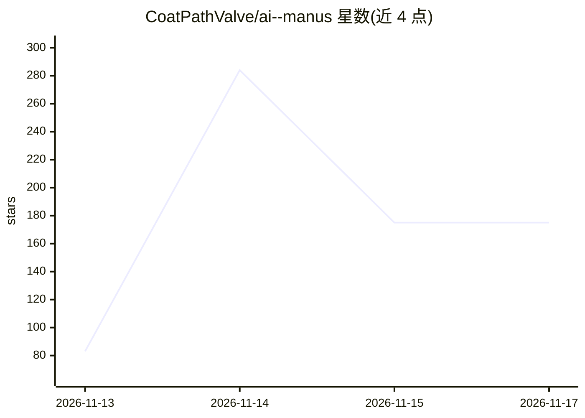

# CoatPathValve/ai--manus

⭐ 175 · Apache-2.0 · 推送 2026-11-15 · [GitHub](https://github.com/CoatPathValve/ai--manus) · 个人维护

**面向个人日常任务的自主 AI Agent：代写并执行代码、操控浏览器**

Manus 是一个自主 AI Agent 系统，在沙箱环境中运行各类工具：自主编写并执行脚本、控制浏览器完成网页导航、表单填写与信息收集，并可跨代码与浏览器组合多步任务。README 定位其为面向家庭、学习与小规模轻量工作的助手，面向非开发者用户，无需编程背景即可使用。文档给出兼容性表（最低 4GB 内存、双核 CPU）与六步上手流程，但未提供具体安装命令、模型接入方式或代码仓库结构说明；功能描述均为宣传性文本，缺少可验证的技术细节。

## 筛选速览

| 维度 | 判定 | 备注 |
|---|---|---|
| AI 角色 | `ai-native` | 本体是模型或模型工具 |
| 许可风险 | `permissive` | Apache-2.0 |
| 部署形态 | `None` |  |
| 模型依赖 | — | README 未给出锁定关系 |
| 硬件要求 | — | 无带数字的原话,不猜 |
| 安装摩擦 | `low` | 无编译、无系统依赖或容器化 |
| 成熟度 | — | 结构信号不足 |

## 能力要点

- 自主编写并执行代码完成任务
- 浏览器控制：导航网页、填表、采集信息
- 代码与浏览器动作可在同一工作流中衔接
- 面向小规模场景的后台个人助手

## 适用场景

- 让学生整理研究笔记并运行小型脚本
- 让 agent 代为浏览多网页收集信息并汇总
- 把重复性小任务委派给后台自动执行

## 场景标签

`AI 助手` `编码 Agent` `浏览器自动化` · 领域:效率与自动化

## 证据(README 行号)

> L10: - **Autonomous Code Execution:** Manus AI agent runs code on its own to complete tasks, so you can focus on decisio
> L18: Manus is an autonomous AI agent designed to run code and control a browser on your behalf. Instead of acting like a

## 星数曲线

2026-11-13 83 → 2026-11-17 175（+92）

---
*卡片 v1 · prompt 1.4 · 生成 2026-11-17 · 置信度 mid · 依据 README sha `0f78ee3a5dd2` · [字段定义](../../DATASET.md)*
