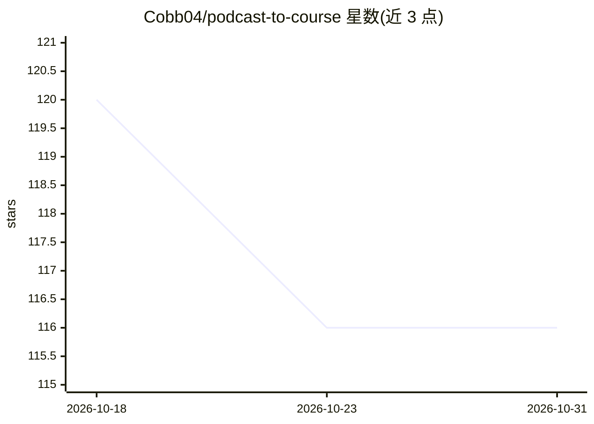

# Cobb04/podcast-to-course

⭐ 116 · CSS · 推送 2026-08-11 · [GitHub](https://github.com/Cobb04/podcast-to-course) · 个人维护 · 中文 README

**把播客转写稿变成框架卡、决策清单与交互式 HTML 课程的 Claude Code 技能**

面向 AI 产品从业者与学习者的 Claude Code 技能：输入小宇宙/公网音频链接或既有转写稿，先经 ingest_podcast.py 在 Apple Silicon Mac 上用 WhisperKit 本地免费转写（含说话人分离、断点续传、尾部幻觉过滤、质量指标），未装 WhisperKit 时可回退通义听悟云端转写；随后生成三种深度输出——10 分钟学习卡、含 claim-ledger/debate-arena 的知识资产组、零依赖交互式 HTML 课程。每条观点带可信度标签，跨集知识库自动连接。安装方式为 git clone 到 ~/.agents/skills 后在 Claude Code 中调用；限制：仅支持公开内容，本地转写需 Apple Silicon Mac。

## 筛选速览

| 维度 | 判定 | 备注 |
|---|---|---|
| AI 角色 | `ai-native` | 本体是模型或模型工具 |
| 许可风险 | `none` | — |
| 部署形态 | `library` | 以包/库形式分发 |
| 模型依赖 | — | README 未给出锁定关系 |
| 硬件要求 | — | 无带数字的原话,不猜 |
| 安装摩擦 | `low` | 无编译、无系统依赖或容器化 |
| 成熟度 | — | 结构信号不足 |

## 能力要点

- WhisperKit 本地免费转写，含说话人分离与词级时间戳，2 小时以上音频用增量加载与 VAD 切块
- 三种输出深度：学习卡 / 框架卡等 markdown 资产 / 交互式 HTML 课程
- claim-ledger + debate-arena 机制：每条核心 claim 带时间戳、锚点、可信度与状态，AI 质疑后才能入长期 wiki
- 支持小宇宙链接、公网音频 URL、通义听悟/飞书妙记/YouTube 等多种转写来源

## 适用场景

- 听完 AI 播客后生成框架卡与决策清单，沉淀到 Notion/Obsidian
- 把里程碑级访谈单集做成可反复复习的交互式 HTML 课程
- 给小宇宙公开单集链接，本地免费完成转写并产出结构化学习资产

## 场景标签

`教程课程` `语音识别` · 领域:学习与行业

## 证据(README 行号)

> L11: 以前它是一个「拿到转写稿以后很能打」的 Skill。现在它长出了产品的前半截：给它一份转写文件，或者直接给一个公开的小宇宙 / 音频链接；它会在 Apple Silicon Mac 上免费本地转写，再产出结构化框架卡、决策清单、面
> L223: git clone https://github.com/Cobb04/podcast-to-course.git ~/.agents/skills/podcast-to-course
> L226: 然后在 Claude Code 里说：*"帮我把这期播客转成课程"*

## 星数曲线

2026-10-18 120 → 2026-10-31 116（-4）

---
*卡片 v1 · prompt 1.4 · 生成 2026-10-23 · 置信度 high · 依据 README sha `c7375c47c9bd` · [字段定义](../../DATASET.md)*
