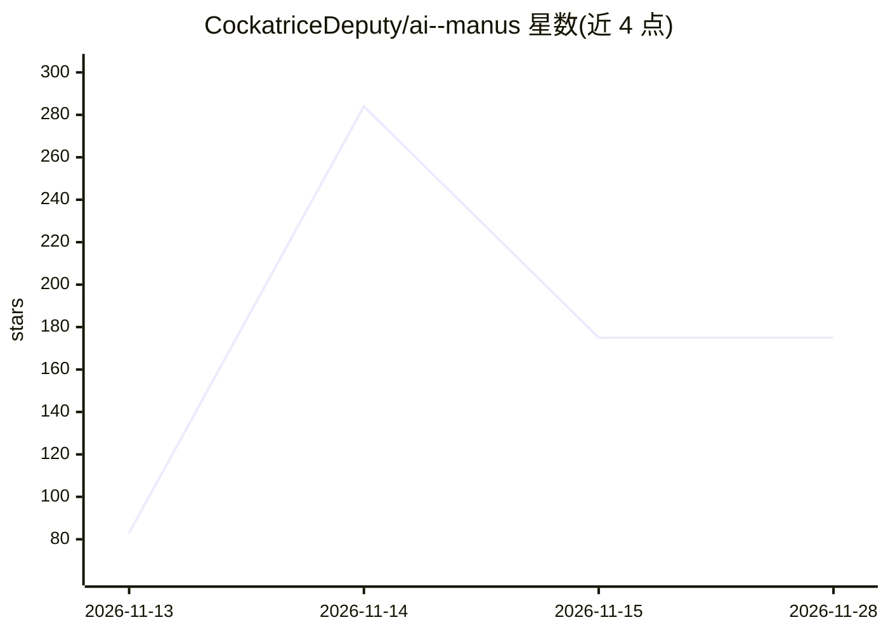

# CockatriceDeputy/ai--manus

⭐ 175 · Apache-2.0 · 推送 2026-11-15 · [GitHub](https://github.com/CockatriceDeputy/ai--manus) · 个人维护

**面向个人日常任务的自主 AI Agent，可执行代码与控制浏览器**

README 以营销式文案描述 Manus 为自主 AI 代理：代替用户编写并执行脚本、控制浏览器完成表单填写与信息收集、执行多步骤任务，定位为家庭、学习与轻量办公场景的个人助手，而非企业平台。文末列出兼容性表（双核 CPU、4GB 内存起）。README 未提供任何安装命令、代码链接、技术架构或模型接入细节，主题标签提及 OpenAI/Anthropic/Gemini 等但正文无对应说明。

## 筛选速览

| 维度 | 判定 | 备注 |
|---|---|---|
| AI 角色 | `ai-native` | 本体是模型或模型工具 |
| 许可风险 | `permissive` | Apache-2.0 |
| 部署形态 | `None` |  |
| 模型依赖 | — | README 未给出锁定关系 |
| 硬件要求 | — | 无带数字的原话,不猜 |
| 安装摩擦 | `low` | 无编译、无系统依赖或容器化 |
| 成熟度 | — | 结构信号不足 |

## 能力要点

- 自主执行代码与控制浏览器完成多步骤任务
- 面向家庭、学习与轻量办公的个人助手定位
- 给出最低兼容性要求（双核 CPU、4GB 内存）

## 适用场景

- 让代理代为执行重复性脚本与网页操作
- 整理研究资料并自动收集多页信息
- 后台处理日程提醒等日常小任务

## 场景标签

`AI 助手` `浏览器自动化` `编码 Agent` · 领域:效率与自动化

## 证据(README 行号)

> L10: - **Autonomous Code Execution:** Manus AI agent runs code on its own to complete tasks, so you can focus on decisio
> L18: Manus is an autonomous AI agent designed to run code and control a browser on your behalf. Instead of acting like a

## 星数曲线

2026-11-13 83 → 2026-11-28 175（+92）

---
*卡片 v1 · prompt 1.4 · 生成 2026-11-17 · 置信度 low · 依据 README sha `0f78ee3a5dd2` · [字段定义](../../DATASET.md)*
