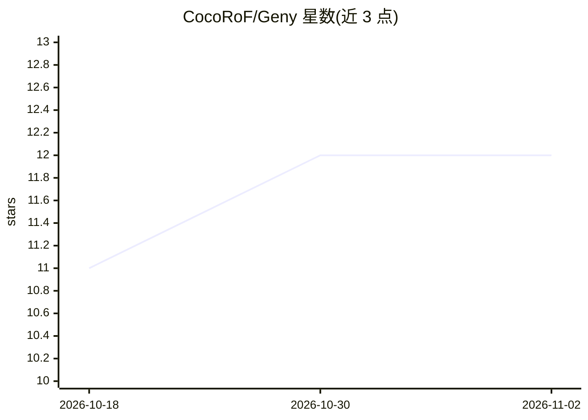

# CocoRoF/Geny

⭐ 12 · Python · Apache-2.0 · 推送 2026-10-01 · [GitHub](https://github.com/CocoRoF/Geny) · [官网](https://geny-x.hrletsgo.me) · 组织维护 · 中文 README

**自托管拟人 AI agent 平台：带形象、语音与记忆的多端 agent**

自部署的 AI agent 服务器与应用套件：每个 agent 拥有人设、Live2D/MMD 头像、语音与记忆库（Opsidian + Synapse 索引），可调用文件/Shell/浏览器/办公文档/MCP 等工具并自建定时自动化。同一 agent 可从 Web、桌面（头像悬浮窗）、Android/iOS 三端访问，共享一个会话。核心执行为发布在 PyPI 的 21 阶段流水线 geny-executor，模型可接 Claude Code/ChatGPT 订阅、16 家 API key 或自托管 Ollama/vLLM。启动无需 GPU 和 API key，通过 ./geny up 或 Docker Compose 部署。

## 筛选速览

| 维度 | 判定 | 备注 |
|---|---|---|
| AI 角色 | `ai-native` | 本体是模型或模型工具 |
| 许可风险 | `permissive` | Apache-2.0 |
| 部署形态 | `desktop` | 安装包/桌面程序 |
| 模型依赖 | local-ok | 支持本地模型 |
| 硬件要求 | — | 无带数字的原话,不猜 |
| 安装摩擦 | `low` | 无编译、无系统依赖或容器化 |
| 成熟度 | `idea` | |

## 能力要点

- 三端（Web/桌面/手机）共享同一 agent 会话，桌面端提供透明置顶头像悬浮窗
- 21 阶段 agent 流水线 geny-executor（PyPI 发布，不依赖 LangChain）
- 记忆库 Opsidian 全量记录并以 Synapse 索引检索，知识存储支持 Synapse/Qdrant
- 支持 Claude Code/ChatGPT 订阅登录、16 家 API key 与自托管 Ollama/vLLM，可会话中切换模型

## 适用场景

- 在自己的服务器上养一个有人设、能记事、会主动说话的私人 AI 助手
- 让 agent 执行写文档、跑代码、搜网页、连 Jira/Notion/Slack 等工具型任务
- 通过桌面头像、手机 App 或 Discord/Telegram/Slack 机器人与同一 agent 对话

## 场景标签

`AI 助手` `语音 Agent` · 领域:对话与助手

## 证据(README 行号)

> L28: You run one Geny server. On it live your agents — each one a conversation that never ends, with its own persona, av
> L30: You reach the same agent from three places — the **web app**, the **desktop app** (where the avatar lives on your s
> L208: Each turn runs through one 21-stage pipeline: input → context (the last turns replayed as messages, memory retriev

## 星数曲线

2026-10-18 11 → 2026-11-02 12（+1）

---
*卡片 v1 · prompt 1.4 · 生成 2026-11-01 · 置信度 mid · 依据 README sha `b24e20e1025d` · [字段定义](../../DATASET.md)*
