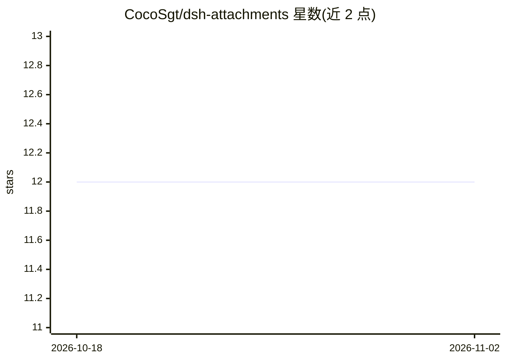

# CocoSgt/dsh-attachments

⭐ 12 · JavaScript · 推送 2026-08-14 · [GitHub](https://github.com/CocoSgt/dsh-attachments) · 个人维护 · 中文 README

**DeepSeek Harness 第三方附件插件：任意文件带入对话，零类型拒绝**

为 DeepSeek Harness (dsh) 提供的第三方附件插件：通过回形针按钮、全窗口拖放与粘贴三种入口，把任意类型文件存入会话工作区 .dsh/uploads/，以卡片形式展示在输入框上方；发送时在 agent/pre-step 阶段把附件列表注入模型请求，由模型自行决定处理方式，不做类型嗅探。宿主侧提供六个 RPC（stashFile 等），路径写入限定于 uploads 目录。限制：每文件 32 MB 传输上限、需要会话有工作区目录、dsh 重启后未发送的卡片丢失且上传目录不自动清理。通过 dsh plugin 命令从 npm 或 GitHub 安装，含中英文双语本地化。

## 筛选速览

| 维度 | 判定 | 备注 |
|---|---|---|
| AI 角色 | `ai-ecosystem` | LLM/agent 周边工具 |
| 许可风险 | `none` | — |
| 部署形态 | `library` | 以包/库形式分发 |
| 模型依赖 | locked-api |  |
| 硬件要求 | — | 无带数字的原话,不猜 |
| 安装摩擦 | `low` | 无编译、无系统依赖或容器化 |
| 成熟度 | — | 结构信号不足 |

## 能力要点

- 任意类型文件（含图片）经 stash 管线进入对话，无类型拒绝
- 发送时在 agent/pre-step 阶段注入附件列表，卡片区 2 秒轮询同步
- 宿主侧六个 RPC，写入限定于 <cwd>/.dsh/uploads/ 并做路径前缀校验
- 按钮/拖放/粘贴三种入口，粘贴含附件引用行的文本可恢复卡片

## 适用场景

- 在 dsh 会话里把设计稿、数据文件等任意文件交给模型处理
- 给不支持图片的模型通过 read_image 按路径读取图片而不被阻塞
- 多客户端同会话时共享附件待发状态

## 场景标签

 · 领域:AI 编码工具/插件

## 证据(README 行号)

> L8: A third-party attachment plugin for DeepSeek Harness (dsh): **bring any file into the conversation, zero type reject
> L26: - **Host half** (`lib/index.js`): `AttachmentsGateway` extends `TypertRemoteService` and serves the `fileStash` nam

## 星数曲线

2026-10-18 12 → 2026-11-02 12（+0）

---
*卡片 v1 · prompt 1.4 · 生成 2026-11-01 · 置信度 high · 依据 README sha `958b88e83c92` · [字段定义](../../DATASET.md)*
