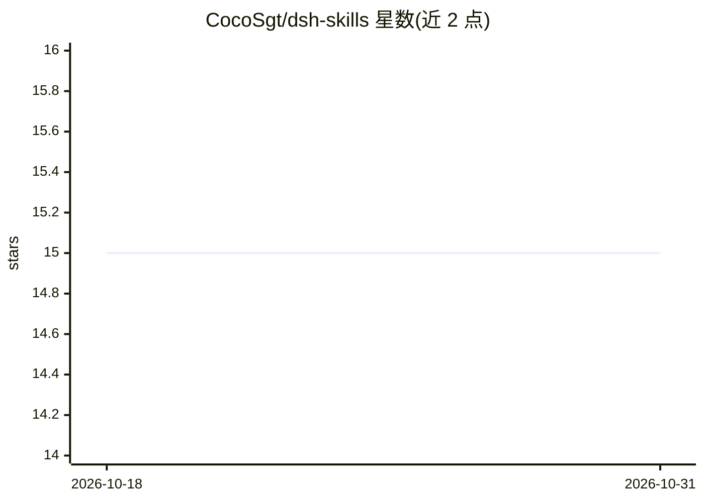

# CocoSgt/dsh-skills

⭐ 15 · JavaScript · NOASSERTION · 推送 2026-08-14 · [GitHub](https://github.com/CocoSgt/dsh-skills) · 个人维护 · 中文 README

**DeepSeek Harness 的第三方技能中心插件：聚合分散技能到全局库**

面向 DeepSeek Harness（dsh）的第三方插件，在设置对话框中增加 Skills 页面：将 Claude Code 的 ~/.claude/skills、项目目录、.skill 包等分散技能聚合到 ~/.dsh/skills 全局库，支持 Link（symlink）与 Copy 两种导入模式，导入后出现在斜杠菜单。架构分宿主端（SkillHubGateway 三个 RPC）与浏览器端，经 npm/GitHub 安装。限制：副本漂移同步为二期功能，Windows 文件级链接无权限时回退为复制。

## 筛选速览

| 维度 | 判定 | 备注 |
|---|---|---|
| AI 角色 | `ai-ecosystem` | LLM/agent 周边工具 |
| 许可风险 | `none` | NOASSERTION |
| 部署形态 | `library` | 以包/库形式分发 |
| 模型依赖 | locked-api |  |
| 硬件要求 | — | 无带数字的原话,不猜 |
| 安装摩擦 | `low` | 无编译、无系统依赖或容器化 |
| 成熟度 | — | 结构信号不足 |

## 能力要点

- Link（symlink）与 Copy 双导入模式，编辑链接即编辑源文件
- Discover 页扫描目录并批量 Link 导入技能
- SKILL.md 编辑与整树导出为 .skill 包
- 宿主/浏览器双端架构，三个 RPC 通道

## 适用场景

- 把散落各处的 agent 技能集中到 dsh 全局库统一管理
- 将 Claude Code 已有技能导入 DeepSeek Harness 使用
- 在线编辑与打包导出技能文件树

## 场景标签

 · 领域:AI 编码代理插件/技能管理

## 证据(README 行号)

> L8: Third-party skill hub for DeepSeek Harness (dsh): **aggregate skills scattered
> L92: dsh plugin --profile web add dsh-skills

## 星数曲线

2026-10-18 15 → 2026-10-31 15（+0）

---
*卡片 v1 · prompt 1.4 · 生成 2026-10-31 · 置信度 high · 依据 README sha `6d52fd9a5a67` · [字段定义](../../DATASET.md)*
