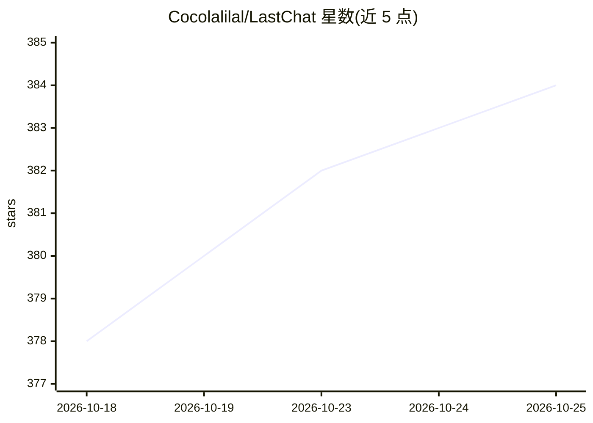

# Cocolalilal/LastChat

⭐ 384 · Kotlin · AGPL-3.0 · 推送 2026-10-24 · [GitHub](https://github.com/Cocolalilal/LastChat) · 个人维护

**Android 端多供应商 AI 聊天助手应用（RikkaHub 分支）**

面向 Android 用户、本地优先的 AI 聊天应用，为 RikkaHub 的分支并重做了 UI。支持多供应商预设与自定义供应商、基于 RAG 的向量记忆（本地存储嵌入与历史）、文本/图像/视频/音频多模态输入。内置 Python（PRoot Linux 环境）与 JavaScript（QuickJS）引擎、Web 搜索、MCP 服务器支持，并提供多助手 Persona 管理、图像生成界面、系统 TTS、Markdown/LaTeX 渲染与 WebDAV 备份。以 Kotlin/Jetpack Compose 构建。

## 筛选速览

| 维度 | 判定 | 备注 |
|---|---|---|
| AI 角色 | `ai-native` | 本体是模型或模型工具 |
| 许可风险 | `viral` | AGPL-3.0 |
| 部署形态 | `None` |  |
| 模型依赖 | — | README 未给出锁定关系 |
| 硬件要求 | — | 无带数字的原话,不猜 |
| 安装摩擦 | `low` | 无编译、无系统依赖或容器化 |
| 成熟度 | — | 结构信号不足 |

## 能力要点

- 多供应商预设与自定义供应商接入，BYOK
- RAG 向量记忆，聊天记录与嵌入本地存储
- 内置 Python（PRoot）与 QuickJS JavaScript 引擎
- 支持 MCP 服务器、Web 搜索、图像生成与 TTS

## 适用场景

- 在 Android 设备上用自有 API key 与多个模型供应商聊天
- 通过 RAG 记忆让助手记住过往对话细节
- 在聊天中运行 Python/JavaScript 代码与调用 MCP 工具
- 用 Persona 与标签管理多个自定义助手

## 场景标签

`聊天机器人` `AI 助手` `Agent 记忆` · 领域:Agent 开发

## 证据(README 行号)

> L7: **LastChat** is a feature-rich AI assistant application for Android. It is a fork of RikkaHub, modified using AI age
> L9: This project aims to provide a privacy-focused and highly personalized AI chat experience on Android
> L24: * **Multi-Provider Support**: Provider presets make it easier to get up and running. There's support for custom pro
> L25: * **RAG Memory**: Features a RAG-based memory system. Assistants can "remember" details from past conversations usi

## 星数曲线

2026-10-18 378 → 2026-10-25 384（+6）

---
*卡片 v1 · prompt 1.4 · 生成 2026-10-21 · 置信度 high · 依据 README sha `040dd250a71b` · [字段定义](../../DATASET.md)*
