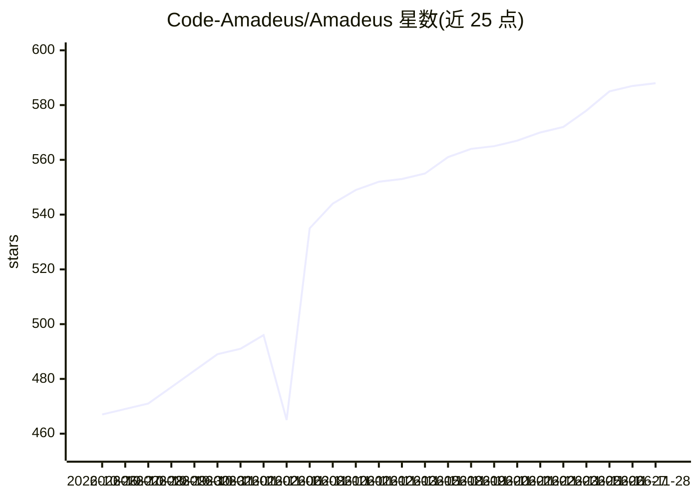

# Code-Amadeus/Amadeus

⭐ 588 · Python · AGPL-3.0 · 推送 2026-11-27 · [GitHub](https://github.com/Code-Amadeus/Amadeus) · 组织维护 · 中文 README

**面向桌面用户的实时多模态 AI 代理，整合语音、角色与任务执行**

以 Electron 桌面应用加本地 Host 后端形式运行的桌面代理：语音对话支持打断（独立唤醒/ASR、两阶段端点检测、AEC/barge-in），角色呈现含字幕、口型与表情同步；主角色将任务委托给注册的 Work Provider（Pi、Codex、Browser、可选 OpenClaw），Host 负责身份、状态、权限与恢复。工作产物经 Artifact Registry 与 AUIP AppSession 协议进行受控交互。按 T1–T4 四档能力分层安装，T1/T2 无需 Torch；公开源码为 0.17.1 Alpha 候选分支，AGPL-3.0 许可，角色包与模型权重不在公开范围内。

## 筛选速览

| 维度 | 判定 | 备注 |
|---|---|---|
| AI 角色 | `ai-native` | 本体是模型或模型工具 |
| 许可风险 | `viral` | AGPL-3.0 |
| 部署形态 | `desktop` | 安装包/桌面程序 |
| 模型依赖 | locked-api |  |
| 硬件要求 | `cpu-ok` | |
| 安装摩擦 | `high` | 编译与系统依赖俱全 |
| 成熟度 | `idea` | |

## 能力要点

- 可打断的实时语音对话：LLM、TTS 与播放全程可中断
- 主角色委托 Work Provider 执行，Host 持有权限与恢复控制
- AUIP AppSession：以短期票据绑定 Artifact 的受控应用协作协议
- T1–T4 安装分层，默认档位不依赖 Torch

## 适用场景

- 通过语音或文字与桌面代理对话并委托任务
- 长时间后台任务的进度、权限与失败恢复管理
- 本地或远程模型配置下的桌面语音助手搭建

## 场景标签

`语音 Agent` `多模态` `AI 助手` · 领域:对话与助手

## 证据(README 行号)

> L20: Amadeus is a **real-time multimodal desktop agent** that brings voice, character presence, and Agent work into one 
> L82: |**Provider Runtime**|Pi over native RPC for daily tasks, Codex App Server / Direct Codex for complex coding, Brows
> L168: |T1 core|Text Chat, Work, Providers, and character rendering|`uv sync --locked`|

## 星数曲线

2026-10-26 467 → 2026-11-28 588（+121）

---
*卡片 v1 · prompt 1.4 · 生成 2026-11-25 · 置信度 high · 依据 README sha `a99a023477b5` · [字段定义](../../DATASET.md)*
