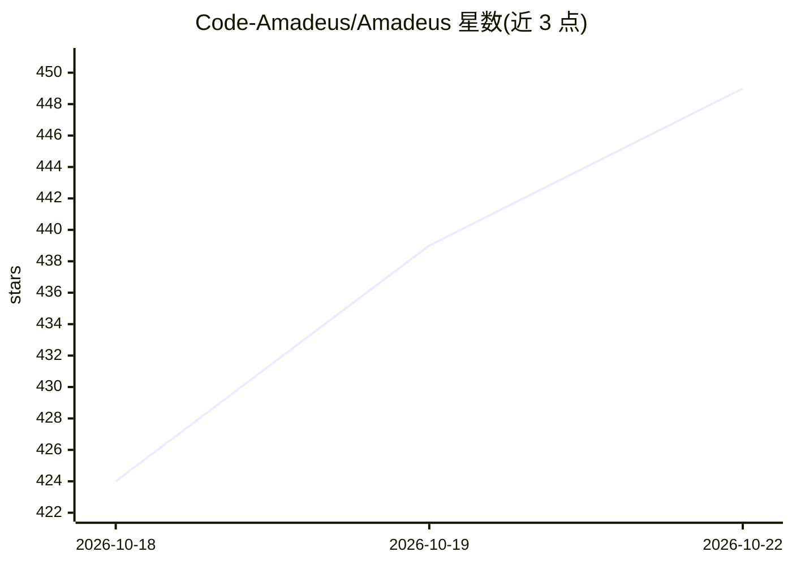

# Code-Amadeus/Amadeus

⭐ 449 · Python · AGPL-3.0 · 推送 2026-10-21 · [GitHub](https://github.com/Code-Amadeus/Amadeus) · 个人维护 · 中文 README

**面向桌面用户的实时多模态 AI 代理：语音、角色形象与任务执行合一**

0.17.1 Alpha 阶段的桌面应用：将可打断的实时语音对话、带字幕/口型/表情的角色呈现、以及通过注册的 Work Providers（Pi、Codex、Browser、可选 OpenClaw）委派执行的任务整合在同一界面。Host 负责身份、状态、权限与恢复，提供 Projects/Artifacts/结构化 diff 等持久工作控制面，并定义 AUIP 协议让 Agent 与产出的工件在受权限约束的 AppSession 中继续协作。支持 DeepSeek 远程主对话与本地 GPT-SoVITS/Qwen3-ASR 语音栈（CUDA/ROCm/MPS/CPU 多档安装配置）。本仓库为可构建源码而非打包桌面发布版；Windows+NVIDIA 为参考平台，源码不含角色包与模型权重。安装按 T1–T4 四档用 uv 管理，未提供打包安装器。

## 筛选速览

| 维度 | 判定 | 备注 |
|---|---|---|
| AI 角色 | `ai-native` | 本体是模型或模型工具 |
| 许可风险 | `viral` | AGPL-3.0 |
| 部署形态 | `desktop` | 安装包/桌面程序 |
| 模型依赖 | locked-api |  |
| 硬件要求 | `gpu-8g` | |
| 安装摩擦 | `high` | 编译与系统依赖俱全 |
| 成熟度 | `idea` | |

## 能力要点

- 跨 LLM/TTS/播放的可打断实时语音对话（Wake/Conversation ASR、两段式断点、AEC/barge-in）
- Work Provider 架构：主角色委派任务给 Pi/Codex/Browser/OpenClaw，按调用粒度授权
- AUIP 应用会话协议：工件经 Host 校验后以短时票据挂载，动作权限受限
- 本地语音栈支持 CUDA cu124/cu128、ROCm、Apple MPS、CPU 多种 Torch 构建档

## 适用场景

- 用语音或文字向桌面角色委派日常任务与编码工作并跟踪进度
- 在带角色形象（口型、表情、字幕）的界面中与 AI 实时对话
- 让 AI 在受权限约束的会话中继续操作其生成的工件

## 场景标签

`语音 Agent` `多模态` `AI 助手` · 领域:对话与助手

## 证据(README 行号)

> L20: Amadeus is a **real-time multimodal desktop agent** that brings voice, character presence, and Agent work into one 
> L33: 1. **Talk — communicate naturally:** speak or type, with interruption across generation, synthesis, and physical pl
> L80: |**Remote Main Chat and local voice**|DeepSeek V4 Flash Main Chat; Qwen3-ASR / SenseVoice; embedded GPT-SoVITS stre

## 星数曲线

2026-10-18 424 → 2026-10-22 449（+25）

---
*卡片 v1 · prompt 1.4 · 生成 2026-10-21 · 置信度 high · 依据 README sha `440f3a195151` · [字段定义](../../DATASET.md)*
