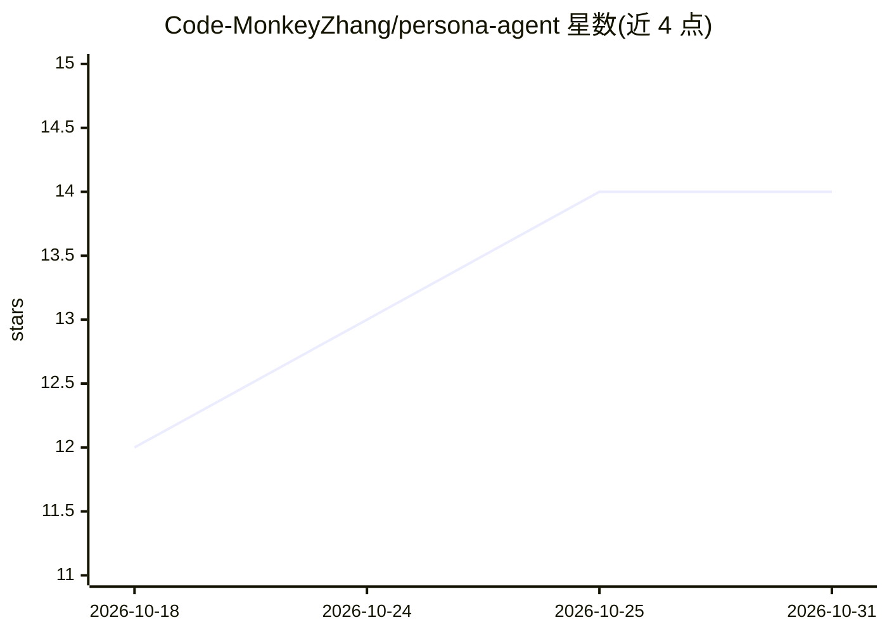

# Code-MonkeyZhang/persona-agent

⭐ 14 · TypeScript · MIT · 推送 2026-10-30 · [GitHub](https://github.com/Code-MonkeyZhang/persona-agent) · [官网](https://code-monkeyzhang.github.io/persona-agent/) · 个人维护 · 中文 README

**开源个人 AI 陪伴助手：自定义性格、声音与立绘**

基于 Electron/React 的桌面端个人 AI Agent 聊天平台（另提供 iOS/Android 移动端），面向个人用户。支持自定义 Agent 立绘、对话背景与语音（MiniMax TTS 驱动，含录音克隆音色），立绘表情随对话情绪切换；提供会话自动总结的长期记忆、MCP 工具与 Agent Skill 分配（支持 Notion/GitHub OAuth）、Agent App 与内置商城；手机端经 Cloudflare Tunnel 远程连接，会话数据本地镜像支持离线浏览。macOS（Apple Silicon/Intel）与 Windows 提供安装包。

## 筛选速览

| 维度 | 判定 | 备注 |
|---|---|---|
| AI 角色 | `ai-native` | 本体是模型或模型工具 |
| 许可风险 | `permissive` | MIT |
| 部署形态 | `None` |  |
| 模型依赖 | — | README 未给出锁定关系 |
| 硬件要求 | — | 无带数字的原话,不猜 |
| 安装摩擦 | `low` | 无编译、无系统依赖或容器化 |
| 成熟度 | — | 结构信号不足 |

## 能力要点

- Agent 立绘/背景/声音全自定义，表情随情绪自动切换
- 长期记忆：会话自动总结并跨会话记忆偏好
- 每个 Agent 可单独分配 MCP 工具与 Skill（含 OAuth MCP）
- 内置商城一键安装 Agent 模板、技能与工具；手机端经 Cloudflare Tunnel 远程访问

## 适用场景

- 创建并自定义一个有形象和声音的个人 AI 陪伴角色
- 给 Agent 挂载 MCP 工具和技能连接 Notion、GitHub 等服务
- 手机端随时随地远程连接桌面上的 Agent 对话

## 场景标签

`聊天机器人` `Agent 记忆` `语音合成` · 领域:Agent 开发

## 证据(README 行号)

> L12: **一个完全可自定义的开源个人 AI 陪伴助手**
> L16: Persona-agent 是一个开源的个人 AI Agent 聊天平台，让你能够完全自定义属于自己的 AI Agent，包括性格、声音和立绘形象，还支持从 Agent 商城一键安装 Agent、MCP 工具和 Skill。Per

## 星数曲线

2026-10-18 12 → 2026-10-31 14（+2）

---
*卡片 v1 · prompt 1.4 · 生成 2026-10-31 · 置信度 high · 依据 README sha `0fddb457fa02` · [字段定义](../../DATASET.md)*
