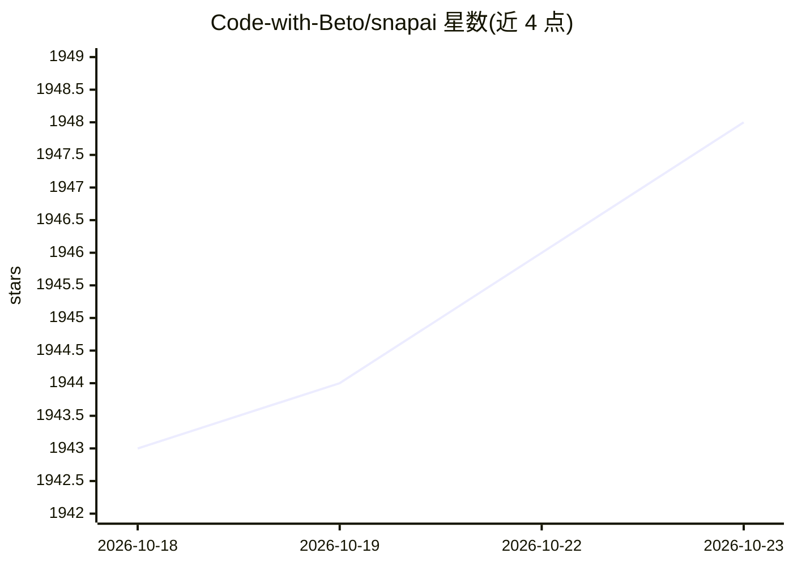

# Code-with-Beto/snapai

⭐ 1,948 · TypeScript · MIT · 推送 2026-07-20 · [GitHub](https://github.com/Code-with-Beto/snapai) · [官网](https://codewithbeto.dev) · 个人维护

**面向 React Native/Expo 开发者的 AI 图标生成 CLI**

Node.js 命令行工具，调用 OpenAI 或 Gemini 图像模型，从终端生成 1024x1024 应用图标与 1024x500 Google Play 特色图形。提供提示词增强、内置样式、多变体生成与消费 API 额度前的提示词预览，支持自定义端点与 GitHub Actions CI 运行；另提供可用 Codex、Claude Code 等 agent 安装的技能包，自动生成资源并更新 app.json 配置。要求 Node.js 18 及以上与 OpenAI 或 Google AI Studio 的 API key；请求直连所选服务商，无自有后端与遥测。生成资源亦可用于任意移动技术栈。

## 筛选速览

| 维度 | 判定 | 备注 |
|---|---|---|
| AI 角色 | `ai-native` | 本体是模型或模型工具 |
| 许可风险 | `permissive` | MIT |
| 部署形态 | `library` | 以包/库形式分发 |
| 模型依赖 | — | README 未给出锁定关系 |
| 硬件要求 | — | 无带数字的原话,不猜 |
| 安装摩擦 | `low` | 无编译、无系统依赖或容器化 |
| 成熟度 | — | 结构信号不足 |

## 能力要点

- 统一 CLI 接入 OpenAI 与 Gemini 图像模型（含多变体与 1K/2K/4K 画质）
- 提示词增强与花费 API 额度前的提示词预览
- 提供 agent 技能包：npx skills add 一键安装，自动更新 iOS/Android 配置
- 无账号、无后端、无遥测，请求直连所选服务商

## 适用场景

- 为我的 Expo/React Native 应用生成应用图标
- 生成 Google Play 商店特色图形横幅
- 在 CI（GitHub Actions）中自动生成图标资源
- 让 AI agent 按自然语言描述生成并配置图标

## 场景标签

`图像生成` · 领域:内容生成

## 证据(README 行号)

> L7: Generate app icon artwork and Google Play feature graphics from the terminal with OpenAI or Google Gemini. SnapAI is
> L24: - OpenAI and Gemini image models behind one consistent CLI

## 星数曲线

2026-10-18 1,943 → 2026-10-23 1,948（+5）

---
*卡片 v1 · prompt 1.4 · 生成 2026-10-21 · 置信度 high · 依据 README sha `28a4278db697` · [字段定义](../../DATASET.md)*
