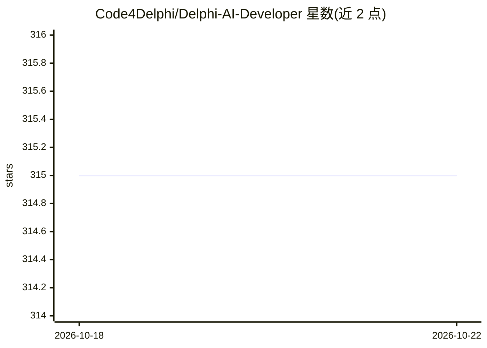

# Code4Delphi/Delphi-AI-Developer

⭐ 315 · Pascal · MIT · 推送 2026-07-14 · [GitHub](https://github.com/Code4Delphi/Delphi-AI-Developer) · [官网](https://code4delphi.com.br/blog/) · 个人维护

**给 Delphi 开发者的 IDE AI 编程助手插件**

Delphi IDE 插件，接入 OpenAI、Gemini、Mistral、Groq API，并支持通过 Ollama 实现离线 AI。功能包括：代码补全（快捷键 Alt+Enter，Tab 接受建议）、AI Chat（可引用当前单元代码、预注册问题、将回复插入编辑器）、数据库交互 Chat（生成数据库参考、执行 AI 返回的 SQL 并以 Grid 展示结果）。安装方式为下载 zip 或克隆项目后在 Delphi 中安装 Package\DelphiAIDeveloper.dpk。支持配置默认 Prompt 与回复语言。

## 筛选速览

| 维度 | 判定 | 备注 |
|---|---|---|
| AI 角色 | `ai-ecosystem` | LLM/agent 周边工具 |
| 许可风险 | `permissive` | MIT |
| 部署形态 | `desktop` | 安装包/桌面程序 |
| 模型依赖 | local-ok | 支持本地模型 |
| 硬件要求 | — | 无带数字的原话,不猜 |
| 安装摩擦 | `low` | 无编译、无系统依赖或容器化 |
| 成熟度 | — | 结构信号不足 |

## 能力要点

- 代码补全与 AI Chat（可引用当前单元/选中代码作为上下文）
- 数据库 Chat：生成数据库参考、执行 AI 生成的 SQL 并展示结果
- 在线 API（OpenAI/Gemini/Mistral/Groq）与 Ollama 离线模式
- 预注册问题、默认 Prompt、仅返回代码等选项

## 适用场景

- 在 Delphi IDE 内获得代码生成与重构建议
- 通过对话对注册的数据库提问并直接执行生成的 SQL
- 离线环境下使用本地 Ollama 模型辅助编码

## 场景标签

`代码生成` `数据分析` · 领域:效率与自动化

## 证据(README 行号)

> L2: Inspired by GitHub Copilot, Delphi AI Developer is a plugin that adds Artificial intelligence (AI) interaction capab
> L4: With Delphi AI Developer, you will have assistance in generating and refactoring code, facilitating and accelerating
> L54: ## 🟠 CODE COMPLETION

## 星数曲线

2026-10-18 315 → 2026-10-22 315（+0）

---
*卡片 v1 · prompt 1.4 · 生成 2026-10-21 · 置信度 high · 依据 README sha `a23f761b89d2` · [字段定义](../../DATASET.md)*
