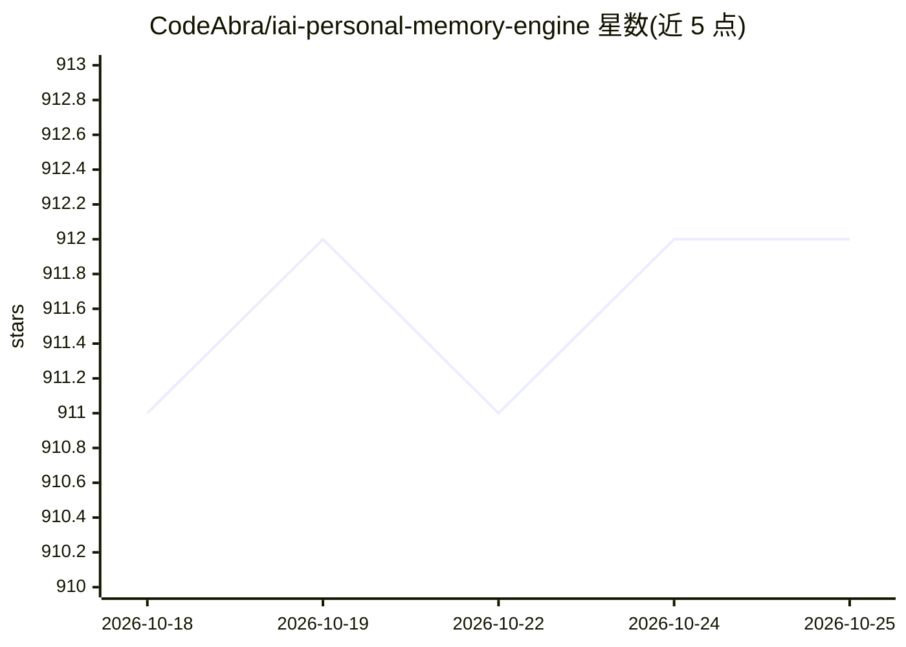

# CodeAbra/iai-personal-memory-engine

⭐ 914 · Python · MIT · 推送 2026-10-23 · [GitHub](https://github.com/CodeAbra/iai-personal-memory-engine) · 个人维护 · 中文 README

**给 AI 编程助手装本地长期记忆的 MCP 服务器**

iai-memory 是运行在本地、通过 MCP 协议服务的个人记忆引擎：逐字捕获 Claude Code、Codex、Cursor 等 AI 编程助手的每轮会话，将片段组织为情景/语义/程序性三层记忆（含超维表征、Leiden 社区检测、Rust 原生引擎），在新会话与每轮开始时注入相关记忆上下文。提供 14 个 MCP 工具、本地仪表盘与 CLI。数据以 AES-256-GCM 加密存储于本地，无账号/遥测/云同步。限制：Windows 为 beta，默认英文优先，单人维护无企业 SLA，前十个会话召回效果较弱。经 PyPI 安装，也可用 bootstrap 脚本从源码构建（需 Git/Python 3.11-3.12/Node 18+/Rust）。

## 筛选速览

| 维度 | 判定 | 备注 |
|---|---|---|
| AI 角色 | `ai-ecosystem` | LLM/agent 周边工具 |
| 许可风险 | `permissive` | MIT |
| 部署形态 | `library` | 以包/库形式分发 |
| 模型依赖 | — | README 未给出锁定关系 |
| 硬件要求 | — | 无带数字的原话,不猜 |
| 安装摩擦 | `low` | 无编译、无系统依赖或容器化 |
| 成熟度 | `idea` | |

## 能力要点

- 逐字捕获会话并在会话/回合级注入记忆上下文（MCP 协议）
- 情景/语义/程序性三层记忆模型，含超维表征与 Leiden 社区检测
- 14 个 MCP 工具：召回（线索/时序/结构/词法）、捕获、矛盾修正、固化与整合
- 本地运行：AES-256-GCM 加密存储、无账号/无遥测、无 API key

## 适用场景

- 让 Claude Code/Codex/Cursor 等编程助手记住我之前说过的话和工作偏好
- 跨会话查阅历史对话原文与项目上下文，无需手动让 AI 记住
- 本地仪表盘搜索、置顶、消退记忆并查看矛盾记录

## 场景标签

`Agent 记忆` · 领域:Agent 开发

## 证据(README 行号)

> L30: A local server that speaks the MCP protocol and gives Claude, and any other
> L137: The local, LLM-free recall path combines semantic similarity, graph evidence,

## 星数曲线

2026-10-18 911 → 2026-10-25 912（+1）

---
*卡片 v1 · prompt 1.4 · 生成 2026-10-21 · 置信度 high · 依据 README sha `38129e769a18` · [字段定义](../../DATASET.md)*
