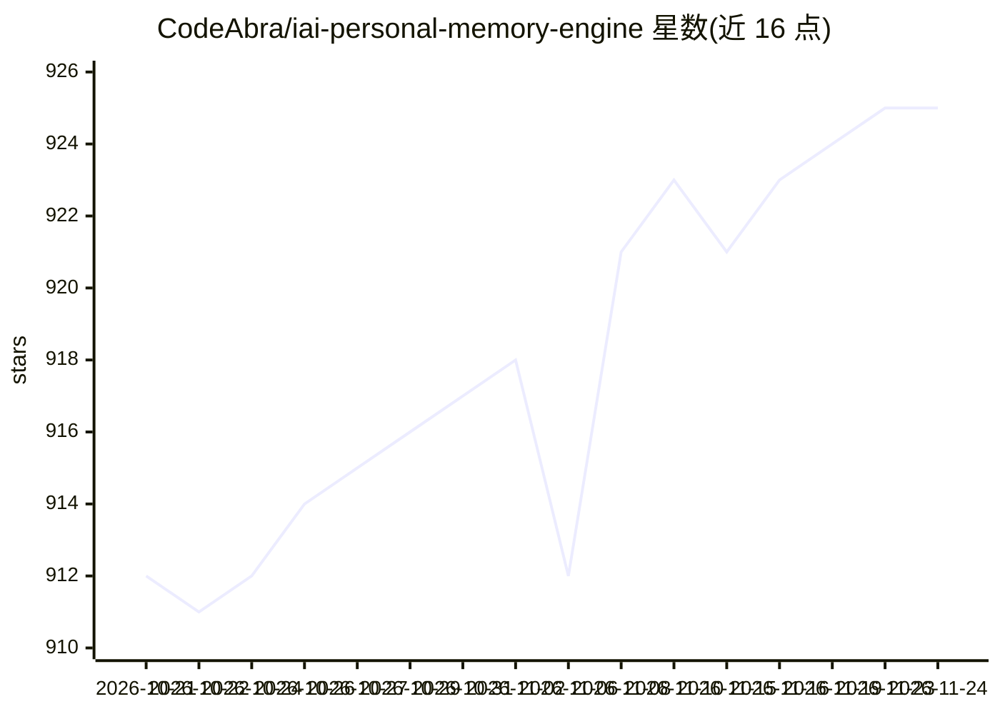

# CodeAbra/iai-personal-memory-engine

⭐ 925 · Python · MIT · 推送 2026-11-13 · [GitHub](https://github.com/CodeAbra/iai-personal-memory-engine) · 个人维护

**为 AI 编程代理提供本地长期记忆的 MCP 记忆引擎**

本地运行的 MCP 服务器，为 Claude Code 等编程代理提供逐字记录的长期记忆：每轮会话被捕获并组织为情景/语义/程序性三层记忆，新会话开始时注入相关记忆片段；支持矛盾修正、衰减与整合，空闲期后台完成嵌入、加密与聚类。提供 15 个 MCP 工具、本地仪表盘与 CLI，支持 Claude Code、Codex、Cursor 等宿主的自动捕获钩子。存储经 AES-256-GCM 加密，引擎与嵌入全部本地运行；夜间 REM 整合步骤默认调用用户的 claude 订阅，可关闭。Windows 为 beta。

## 筛选速览

| 维度 | 判定 | 备注 |
|---|---|---|
| AI 角色 | `ai-ecosystem` | LLM/agent 周边工具 |
| 许可风险 | `permissive` | MIT |
| 部署形态 | `library` | 以包/库形式分发 |
| 模型依赖 | locked-api |  |
| 硬件要求 | — | 无带数字的原话,不猜 |
| 安装摩擦 | `low` | 无编译、无系统依赖或容器化 |
| 成熟度 | — | 结构信号不足 |

## 能力要点

- 逐字捕获每轮会话并组织为情景/语义/程序性三层记忆
- MCP 协议兼容任意 MCP-over-stdio 客户端，提供 15 个记忆工具
- 本地无 LLM 召回路径：语义相似度+图证据+时间有效性+词法证据
- AES-256-GCM 静态加密，无账号、无遥测

## 适用场景

- 让 Claude Code/Codex 跨会话记住我的决定与上下文
- 本地保存与 AI 的全部对话且可检索、可修正矛盾
- 替代每次手动向 agent 重述背景信息

## 场景标签

`Agent 记忆` · 领域:Agent 开发

## 证据(README 行号)

> L30: A local server that speaks the MCP protocol and gives Claude, and any other
> L33: and serves a small slice of relevant memory back at the start of each new
> L103: MCP tools work with any MCP-over-stdio client; automatic capture and context

## 星数曲线

2026-10-21 912 → 2026-11-24 925（+13）

---
*卡片 v1 · prompt 1.4 · 生成 2026-11-24 · 置信度 high · 依据 README sha `a1f4b8765be5` · [字段定义](../../DATASET.md)*
