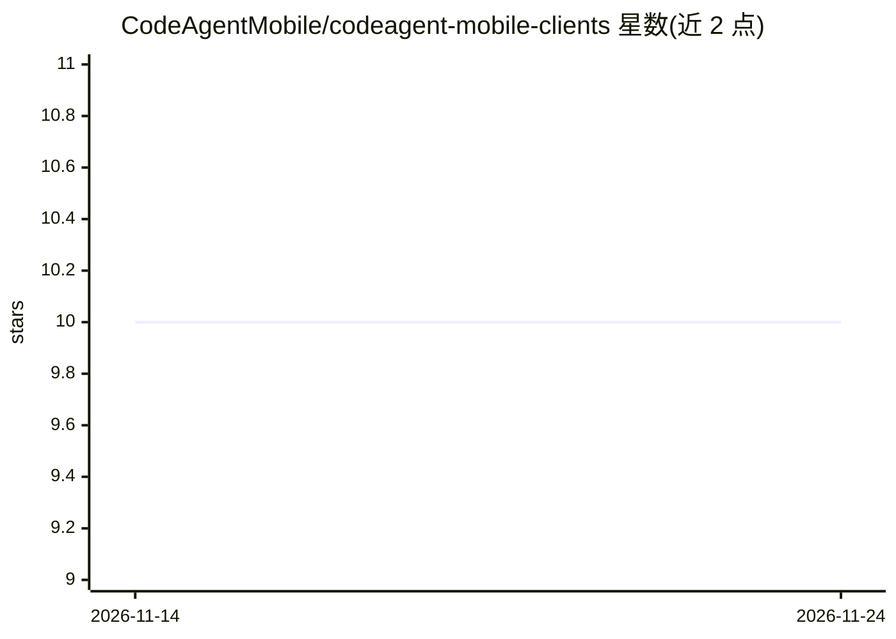

# CodeAgentMobile/codeagent-mobile-clients

⭐ 10 · TypeScript · MIT · 推送 2026-11-06 · [GitHub](https://github.com/CodeAgentMobile/codeagent-mobile-clients) · [官网](https://www.codeagent-mobile.com) · 个人维护

**让开发者在手机上远程监督 IDE 中 AI 编码 agent 的客户端桥**

CodeAgent Mobile 的客户端源码仓库，包含三部分：npm 发布的 codeam-cli（将 Claude Code 包装进 PTY 并流式转发）、VS Code/Cursor/Windsurf 扩展、JetBrains 系 IDE 插件。各客户端不互相直连，而是接入后端中继，把 IDE 中已在运行的 agent 会话流式转发到手机或 Web 仪表盘，用户可异步批准 diff、修改提示词。安装方式为 npm 全局安装或各 IDE 市场安装，亦提供源码构建（Node ≥ 18，CLI 在 macOS/Linux 需 Python 3，JetBrains 插件构建需 JDK 17）。

## 筛选速览

| 维度 | 判定 | 备注 |
|---|---|---|
| AI 角色 | `ai-ecosystem` | LLM/agent 周边工具 |
| 许可风险 | `permissive` | MIT |
| 部署形态 | `library` | 以包/库形式分发 |
| 模型依赖 | — | README 未给出锁定关系 |
| 硬件要求 | — | 无带数字的原话,不猜 |
| 安装摩擦 | `medium` | 含编译或系统依赖之一 |
| 成熟度 | — | 结构信号不足 |

## 能力要点

- CLI 将 Claude Code 包入 PTY 并流式转发到任意设备
- 提供 VS Code/Cursor/Windsurf 扩展与 IntelliJ 系插件三个客户端
- 通过环境变量 CODEAM_API_URL/CODEAM_TEST_MODE 切换自托管或 dev 预览后端
- 三个客户端自 2.0.0 起统一版本线并带自动化发布门禁

## 适用场景

- AI agent 在 IDE 里长时间运行时，用手机异步批准 diff 和调整提示
- 在终端用 codeam 命令启动 Claude Code 并获得移动端控制
- 自托管或指向自定义后端端点部署客户端桥

## 场景标签

 · 领域:开发者工具/AI 编码工作流

## 证据(README 行号)

> L3: Public source for the **client-side bridges** of CodeAgent Mobile — the workflow-continuity layer for AI coding agen
> L10: > The supervision layer for agents already running in your IDE. Now that AI agents run for hours, not seconds, you 
> L165: The clients never talk to each other. Each one connects to the backend relay and relays commands to whichever loca

## 星数曲线

2026-11-14 10 → 2026-11-24 10（+0）

---
*卡片 v1 · prompt 1.4 · 生成 2026-11-20 · 置信度 high · 依据 README sha `d1014a5ccb4d` · [字段定义](../../DATASET.md)*
