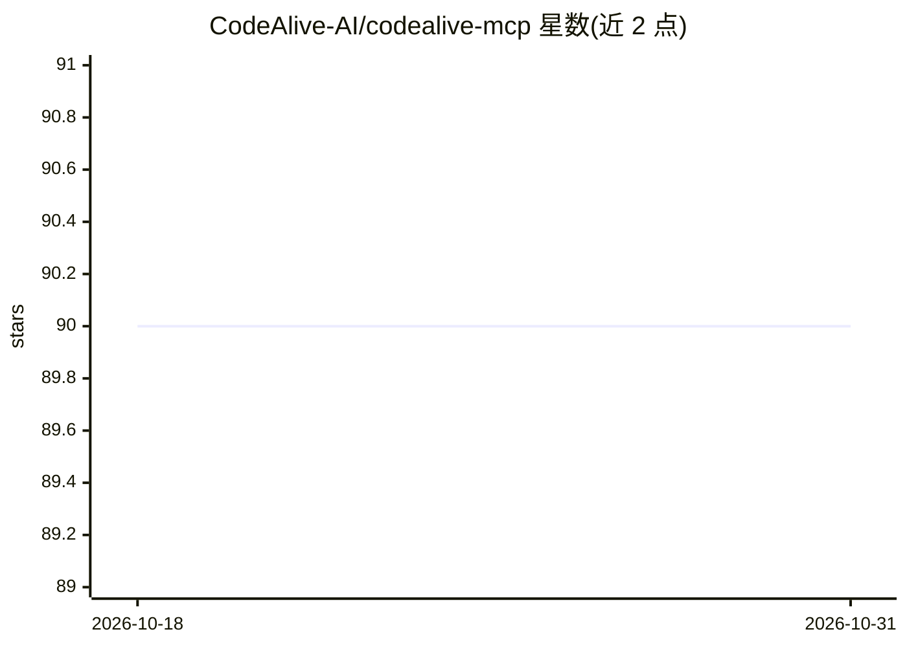

# CodeAlive-AI/codealive-mcp

⭐ 90 · Python · MIT · 推送 2026-09-24 · [GitHub](https://github.com/CodeAlive-AI/codealive-mcp) · [官网](https://www.codealive.ai/) · 组织维护

**面向大型代码库的 MCP 上下文引擎：给 AI 编程代理提供精确仓库上下文**

CodeAlive 是基于图谱检索的代码库上下文引擎，通过 MCP 服务器暴露给 Claude Code、Cursor、VS Code Copilot 等 30 余种 AI 客户端。提供 11 个工具，包括语义搜索、grep 搜索、仓库本体、文件树读取、调用/继承关系展开、元数据查询与 chat 问答。README 称在 RepoQA 基准中达到前沿代理水平且模型成本约低 25 倍、语义搜索减少 45% token。最快接入方式为远程 MCP（需注册 API key），也支持本地源码运行（Python 3.11+、uv）与 Docker Compose 部署，OAuth 2.1 与 API key 两种认证。

## 筛选速览

| 维度 | 判定 | 备注 |
|---|---|---|
| AI 角色 | `ai-ecosystem` | LLM/agent 周边工具 |
| 许可风险 | `permissive` | MIT |
| 部署形态 | `desktop` | 安装包/桌面程序 |
| 模型依赖 | — | README 未给出锁定关系 |
| 硬件要求 | — | 无带数字的原话,不猜 |
| 安装摩擦 | `low` | 无编译、无系统依赖或容器化 |
| 成熟度 | — | 结构信号不足 |

## 能力要点

- 11 个 MCP 工具：semantic_search、grep_search、get_repository_ontology、get_artifact_relationships 等
- 远程 MCP 端点即可接入，无需本地安装
- 支持 Docker Compose 部署为团队共享 HTTP 服务
- OAuth 2.1 与 Bearer API key 两种认证方式

## 适用场景

- 让 AI 编程助手在大型代码库中用语义搜索定位相关代码
- 通过调用图、继承关系等结构信息理解代码库全貌
- 团队自建共享的代码上下文 MCP 服务

## 场景标签

`RAG` `语义搜索` · 领域:知识与检索

## 证据(README 行号)

> L7: This MCP (Model Context Protocol) server enables AI clients like Claude Code, Cursor, Claude Desktop, Continue, VS C
> L11: CodeAlive is a Context Engine for large codebases, powered by graph-based retrieval and exposed through MCP. It giv

## 星数曲线

2026-10-18 90 → 2026-10-31 90（+0）

---
*卡片 v1 · prompt 1.4 · 生成 2026-10-23 · 置信度 high · 依据 README sha `0a41238152ed` · [字段定义](../../DATASET.md)*
