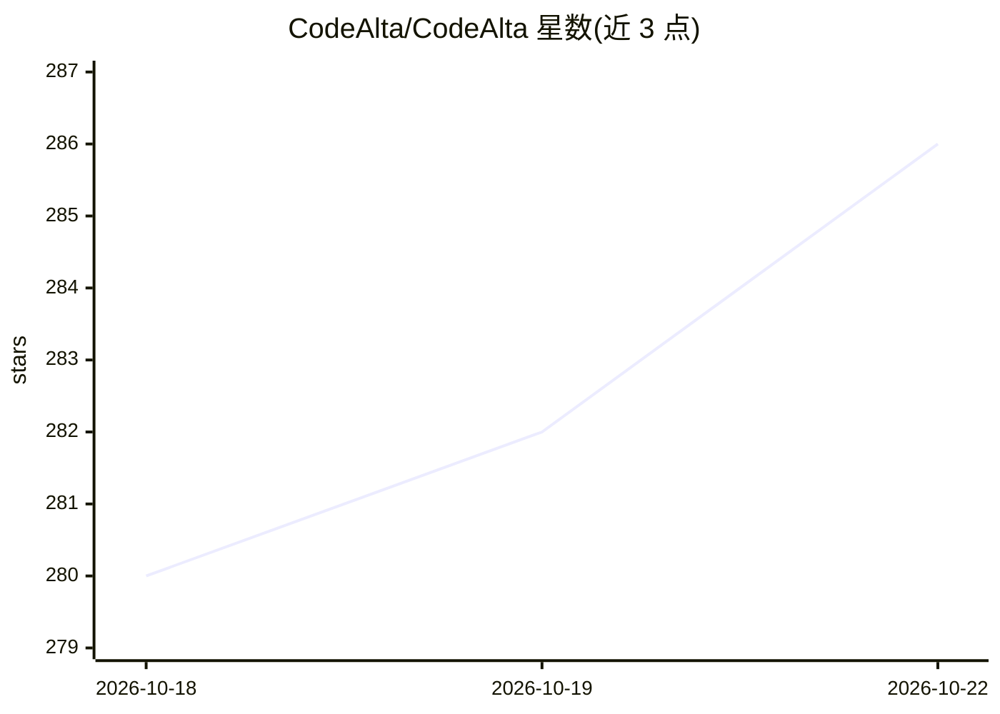

# CodeAlta/CodeAlta

⭐ 286 · C# · BSD-2-Clause · 推送 2026-10-22 · [GitHub](https://github.com/CodeAlta/CodeAlta) · [官网](https://codealta.github.io) · 个人维护

**AI 编码 agent 的桌面/TUI 工作区：会话、Git 与多模型接入**

面向使用 AI 编码 agent 的开发者的开源工作区，提供 Desktop 桌面应用与终端 TUI 两种形态，共享配置与会话。功能包括多面板会话运行与委派、会话分叉回退、文件/图片/PDF 附件、本地语音转提示词、本地索引搜索、Git worktree、issue/PR 浏览、定时/事件触发自动化、插件、本地统计与上下文用量显示。接入 Claude、ChatGPT、GitHub Copilot 订阅或 API key，支持 MCP 与技能。需先安装 .NET 10，声明无遥测。

## 筛选速览

| 维度 | 判定 | 备注 |
|---|---|---|
| AI 角色 | `ai-ecosystem` | LLM/agent 周边工具 |
| 许可风险 | `permissive` | BSD-2-Clause |
| 部署形态 | `None` |  |
| 模型依赖 | — | README 未给出锁定关系 |
| 硬件要求 | — | 无带数字的原话,不猜 |
| 安装摩擦 | `medium` | 含编译或系统依赖之一 |
| 成熟度 | — | 结构信号不足 |

## 能力要点

- Desktop 与 TUI 双形态，共享 profile、providers 与会话
- 会话分叉/回退、委派、排队与审批式提交流程
- 接入 Claude Code/Codex/Copilot 订阅或 API，支持多账号与模型分层回退
- 本地语音转提示词与本地语义搜索（模型在本机运行）

## 适用场景

- 在分屏会话中并行运行并管理多个 AI 编码 agent
- 跨 GitHub/GitLab/Azure DevOps/Bitbucket/Jira 处理 issue 与 PR 工作流
- 按项目隔离 providers、MCP 服务器与技能配置（Spaces）

## 场景标签

`编码 Agent` · 领域:编码与开发

## 证据(README 行号)

> L3: CodeAlta is an open-source workspace for AI coding agents, local code, terminals and Git. It runs on Windows, macOS 
> L25: Launch the app from a project folder. On first launch it opens the provider setup: sign in with a Claude, ChatGPT o

## 星数曲线

2026-10-18 280 → 2026-10-22 286（+6）

---
*卡片 v1 · prompt 1.4 · 生成 2026-10-22 · 置信度 high · 依据 README sha `177eba054778` · [字段定义](../../DATASET.md)*
