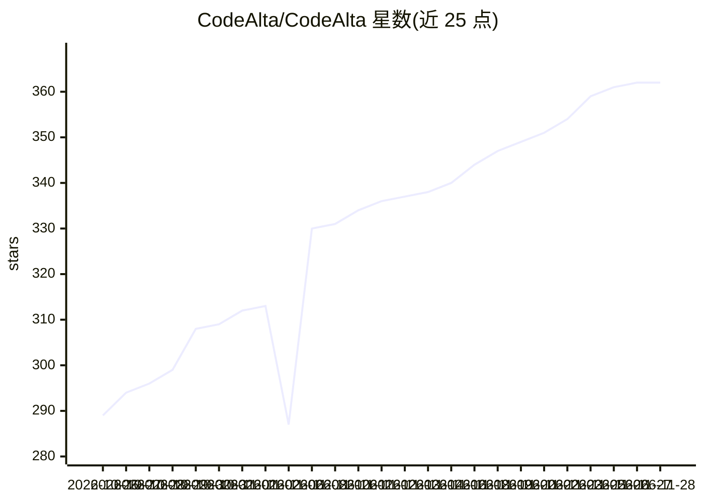

# CodeAlta/CodeAlta

⭐ 362 · C# · BSD-2-Clause · 推送 2026-11-26 · [GitHub](https://github.com/CodeAlta/CodeAlta) · [官网](https://codealta.io) · 组织维护

**多机协同的 AI 编码 agent 工作区：统一管理代理、终端与 Git**

开源的 agentic 开发环境，把 AI 编码代理、代码、终端和 Git 集中在一个工作区，可在单机、多台机器或团队服务器上运行会话。提供桌面应用、终端 UI、CLI 和 Node/Server 组件；代理运行在用户自己的机器上。声明无遥测数据。Fleet 模式支持会话跨机迁移、按标签调度自动化任务；本地模型路径通过 llama.cpp 服务器按机器 GPU 架构安装并从 Hugging Face 下载 GGUF 模型。声明在 SWE-bench Pro 部分任务上与 Claude Code、Codex 对比的结果。

## 筛选速览

| 维度 | 判定 | 备注 |
|---|---|---|
| AI 角色 | `ai-ecosystem` | LLM/agent 周边工具 |
| 许可风险 | `permissive` | BSD-2-Clause |
| 部署形态 | `None` |  |
| 模型依赖 | local-ok | 支持本地模型 |
| 硬件要求 | — | 无带数字的原话,不猜 |
| 安装摩擦 | `medium` | 含编译或系统依赖之一 |
| 成熟度 | — | 结构信号不足 |

## 能力要点

- 桌面/TUI/CLI/Node/Server 五种形态，跨 Windows、macOS、Linux
- Fleet 跨机会话迁移、按标签调度与端到端加密中继
- 本地模型服务器按机器 GPU（CUDA/ROCm/Vulkan/Metal）安装 llama.cpp 并下载 GGUF
- 会话分叉回退、工作树管理、自动化调度与本地统计

## 适用场景

- 在多台机器上统一运行和调度 AI 编码代理会话
- 团队通过 Server 集中管理成员、机器与预算
- 用本地 llama.cpp 模型为代理提供推理后端
- 从手机或终端远程跟进和干预代理任务

## 场景标签

`编码 Agent` · 领域:编码与开发

## 证据(README 行号)

> L5: CodeAlta is an open-source agentic development environment, local and distributed: AI coding agents, your code, term
> L96: - **Model choice**: use Claude Code, Codex, GitHub Copilot or Mistral Vibe subscriptions, APIs (OpenCode Zen and Go

## 星数曲线

2026-10-26 289 → 2026-11-28 362（+73）

---
*卡片 v1 · prompt 1.4 · 生成 2026-11-25 · 置信度 high · 依据 README sha `0a43f33818df` · [字段定义](../../DATASET.md)*
