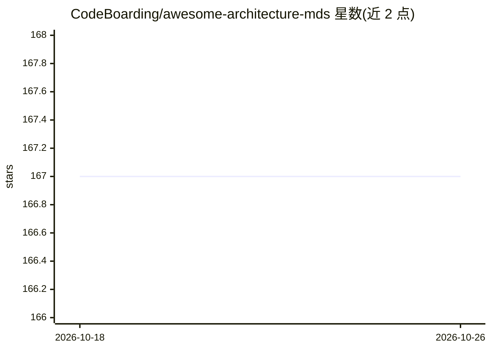

# CodeBoarding/awesome-architecture-mds

⭐ 167 · 推送 2026-08-25 · [GitHub](https://github.com/CodeBoarding/awesome-architecture-mds) · [官网](https://github.com/CodeBoarding/CodeBoarding) · 组织维护

**热门开源仓库架构文档合集：给编码 agent 做上下文**

由 CodeBoarding 维护的开源仓库架构图文档合集：每个仓库映射为统一方式的架构 markdown 与 onboarding 文档，可粘贴进 ARCHITECTURE.md 或在提示词中直接引用 URL，供 Cursor、Claude Code、Aider 等编码 agent 以更少 token 完成仓库上手。目录按 LLM 推理服务、Agent 框架、AI 编码工具等类别组织，覆盖 vllm、langchain、autogen 等条目并标注实现语言。使用方式为 curl 拉取或链接引用，非可安装软件。

## 筛选速览

| 维度 | 判定 | 备注 |
|---|---|---|
| AI 角色 | `ai-knowledge` | 知识聚合/清单类 |
| 许可风险 | `none` | — |
| 部署形态 | `self-host` | docker 或自建部署 |
| 模型依赖 | — | README 未给出锁定关系 |
| 硬件要求 | — | 无带数字的原话,不猜 |
| 安装摩擦 | `low` | 无编译、无系统依赖或容器化 |
| 成熟度 | — | 结构信号不足 |

## 能力要点

- 以统一方式为各开源仓库生成架构 markdown 与 onboarding 文档
- 按 LLM 推理/Agent 框架/AI 编码工具等类别组织条目并标注语言
- 提供 curl 拉取与提示词内直接引用 URL 两种接入方式

## 适用场景

- 让编码 agent 上手陌生仓库前先加载其架构上下文
- 查找各开源 AI 项目的架构组织方式
- 作为团队新成员的仓库架构速览材料

## 场景标签

`精选清单` · 领域:学习与行业

## 证据(README 行号)

> L3: > Architecture diagrams for popular open-source repos. Auto-generated, markdown, drop-in-ready for your coding agent
> L15: **Onboard your AI agent.** Paste the markdown into your ARCHITECTURE.md so the agent onboards in fewer tokens.

## 星数曲线

2026-10-18 167 → 2026-10-26 167（+0）

---
*卡片 v1 · prompt 1.4 · 生成 2026-10-22 · 置信度 mid · 依据 README sha `ae93df6172dc` · [字段定义](../../DATASET.md)*
