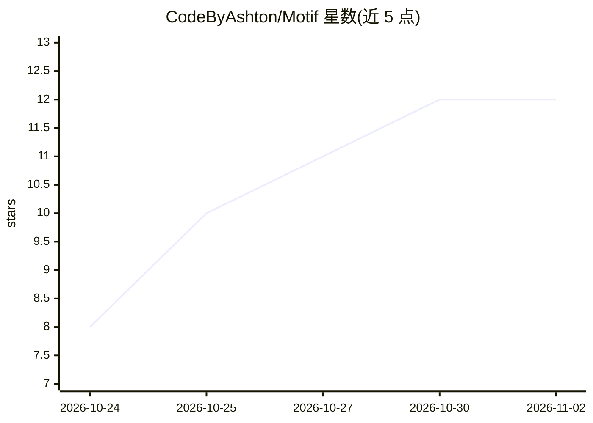

# CodeByAshton/Motif

⭐ 12 · TypeScript · Apache-2.0 · 推送 2026-10-19 · [GitHub](https://github.com/CodeByAshton/Motif) · 个人维护

**给小说作者的 Obsidian 插件：AI 追踪每个角色的位置与所知**

面向用 Obsidian 写小说的作者的插件：写完一章后点击 Sync，把章节发给用户自带的大模型，自动将每个角色的位置、关系与所知更新为 Codex 笔记中的时间线条目；悬停任意角色名可查看其在当前章节的状态，另有 Timeline、关系 Graph、AI 校对（错字/语法/用词/长句）、选区改写与续写等工具。所有数据为 vault 内纯 Markdown。支持 Claude Code、Anthropic、OpenAI、OpenRouter、Ollama、LM Studio 及 OpenAI 兼容服务，可完全本地运行。版本 0.1.1 为早期发布，仅桌面端，API key 以未加密方式存储。

## 筛选速览

| 维度 | 判定 | 备注 |
|---|---|---|
| AI 角色 | `ai-enhanced` | 去掉 AI 部分产品仍成立 |
| 许可风险 | `permissive` | Apache-2.0 |
| 部署形态 | `library` | 以包/库形式分发 |
| 模型依赖 | local-ok | 支持本地模型 |
| 硬件要求 | — | 无带数字的原话,不猜 |
| 安装摩擦 | `low` | 无编译、无系统依赖或容器化 |
| 成熟度 | `idea` | |

## 能力要点

- 按章同步：AI 读取章节并更新角色位置/关系/所知到 Codex
- 悬停角色名显示其在当前章节的状态，Timeline/Graph 可回溯
- AI 校对与选区改写、续写、头脑风暴、连续性检查等写作工具
- 自带模型（BYO AI），支持 Ollama/LM Studio 本地运行

## 适用场景

- 写长篇小说时追踪每个角色在哪、知道什么
- 维护随剧情推进自动更新的故事圣经（Codex）
- 在写作工具里直接做 AI 校对和选区改写

## 场景标签

`知识库管理` `AI 写作` · 领域:内容生成

## 证据(README 行号)

> L7: Motif is an Obsidian plugin for keeping track of a novel while you write it. When you finish a chapter, an AI reads 
> L9: It also has a proofreader and some writing tools that work on the passage you select. Everything is plain Markdown i

## 星数曲线

2026-10-24 8 → 2026-11-02 12（+4）

---
*卡片 v1 · prompt 1.4 · 生成 2026-11-01 · 置信度 high · 依据 README sha `a2d02014e6b2` · [字段定义](../../DATASET.md)*
