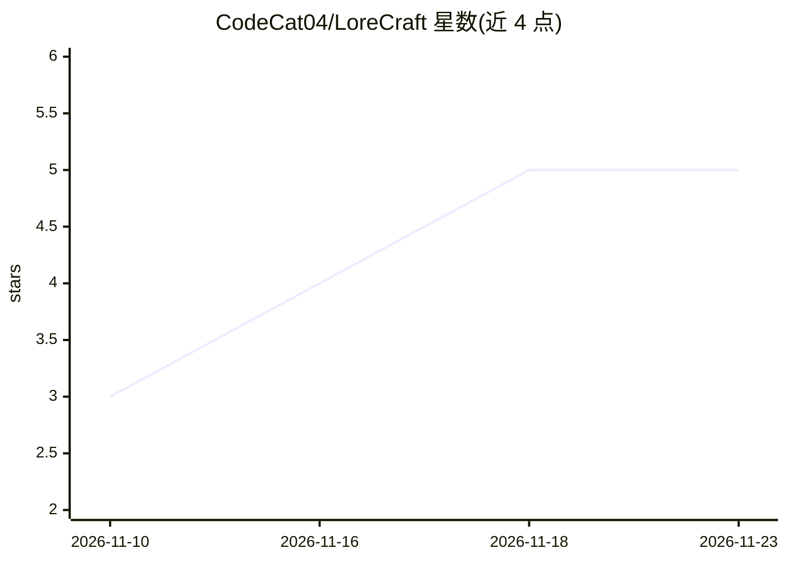

# CodeCat04/LoreCraft

⭐ 5 · TypeScript · AGPL-3.0 · 推送 2026-11-08 · [GitHub](https://github.com/CodeCat04/LoreCraft) · 个人维护

**本地优先的世界观 wiki 与小说写作应用，AI 助手通读你的设定**

LoreCraft 是一个桌面端创作工具：用 Wikipedia 式的 wiki 管理虚构世界设定（infobox、家族树、关系图、地图、时间线），旁挂小说手稿编辑器（binder、场景管理、字数目标），并对两者做一致性检查——规则检查捕捉不可能的日期与死而复生的角色，AI 检查引用原文双方对比。AI 编辑以 tracked change 形式提交，用户逐条接受或拒绝；标记 local only 的内容永不发送到云端。AGPL-3.0，无遥测，处于早期 alpha。

## 筛选速览

| 维度 | 判定 | 备注 |
|---|---|---|
| AI 角色 | `ai-enhanced` | 去掉 AI 部分产品仍成立 |
| 许可风险 | `viral` | AGPL-3.0 |
| 部署形态 | `desktop` | 安装包/桌面程序 |
| 模型依赖 | local-ok | 支持本地模型 |
| 硬件要求 | — | 无带数字的原话,不猜 |
| 安装摩擦 | `low` | 无编译、无系统依赖或容器化 |
| 成熟度 | `idea` | |

## 能力要点

- wiki + 手稿 + 一致性检查三合一，AI 发现需同时引用 lore 与手稿出处
- 本地模型经 llama.cpp/LM Studio/Ollama 等兼容服务器运行，数据不出本机
- 200+ 写作风格库、Canvas 研究画板（开放 JSON Canvas 格式）、多格式导出（PDF/DOCX/EPUB/lorebook）
- 内置 MCP 服务器，供 Claude Code / OpenCode 等外部 AI 工具读取与建议修改

## 适用场景

- 长篇连载小说的设定管理与一致性校对
- 完全离线环境下用本地模型辅助写作
- 从 MediaWiki/Markdown 导入既有世界观笔记并迁移
- 与 Claude Code 配合让外部 AI 读取 lore 并提修改建议

## 场景标签

`AI 写作` `知识库管理` · 领域:内容生成

## 证据(README 行号)

> L10:  A worldbuilding wiki and novel writer, with an AI companion that knows your world.
> L58: **An AI that keeps your world straight.** Select text and ask for a change, or send it to the AI pane. Every edit a
> L74: - **Local models** through any OpenAI-compatible server, such as llama.cpp, LM Studio or Ollama. Nothing leaves you

## 星数曲线

2026-11-10 3 → 2026-11-23 5（+2）

---
*卡片 v1 · prompt 1.4 · 生成 2026-11-21 · 置信度 high · 依据 README sha `1cd8035d5eb5` · [字段定义](../../DATASET.md)*
