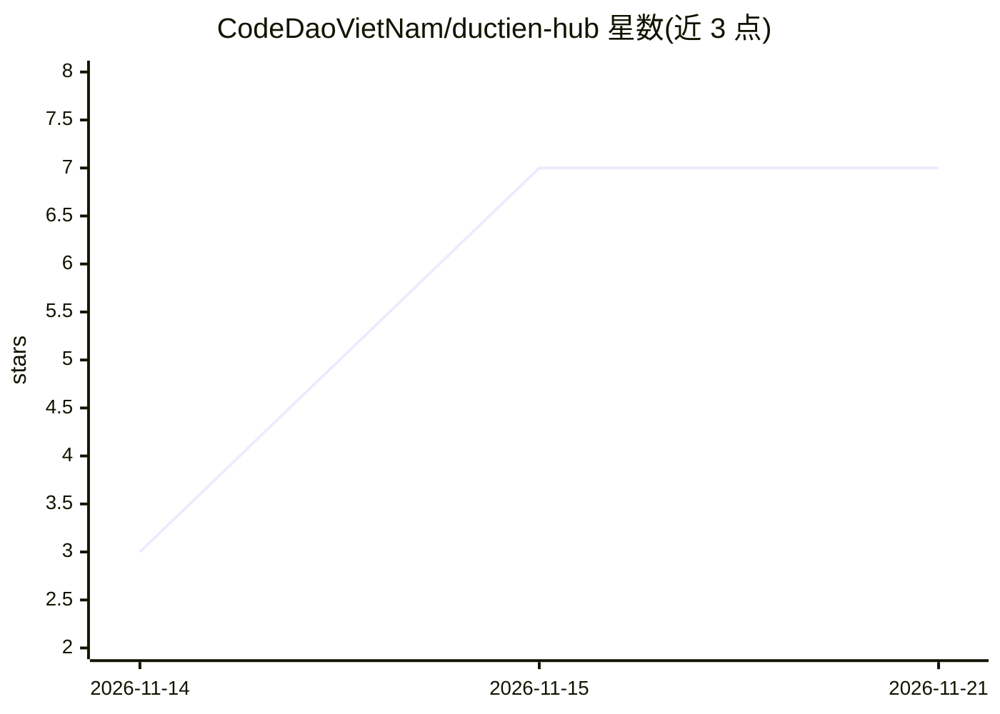

# CodeDaoVietNam/ductien-hub

⭐ 7 · TypeScript · 推送 2026-11-14 · [GitHub](https://github.com/CodeDaoVietNam/ductien-hub) · 组织维护 · 中文 README

**给企业团队的多智能体编排工作区：一个问题路由到合适的 agent**

SSO 保护的对话工作区，编排器把每个问题交给合适的专家 agent（内置、A2A、Copilot Studio 或 Azure AI Foundry 上的 prompt agent），可调用 MCP 工具并检索 SharePoint 文档。提供流式聊天与步骤展示、管理员工作区、模型评判的评测用例及 tokens/延迟/最活跃 agent 的仪表盘，并经 Azure Bot Service 在 Teams 中提供同一 agent。三个部署件（frontend/backend/agent）由 Terraform 部署到 Azure，本地可用 pip/npm 或 docker compose 运行。

## 筛选速览

| 维度 | 判定 | 备注 |
|---|---|---|
| AI 角色 | `ai-ecosystem` | LLM/agent 周边工具 |
| 许可风险 | `none` | — |
| 部署形态 | `library` | 以包/库形式分发 |
| 模型依赖 | — | README 未给出锁定关系 |
| 硬件要求 | — | 无带数字的原话,不猜 |
| 安装摩擦 | `low` | 无编译、无系统依赖或容器化 |
| 成熟度 | — | 结构信号不足 |

## 能力要点

- 编排器按问题路由到内置/A2A/Copilot Studio/Foundry agent
- MCP 工具调用与 SharePoint 知识库检索
- 模型评判的评测用例与用量仪表盘
- 经 Azure Bot Service 在 Microsoft Teams 中应答

## 适用场景

- 企业内搭建统一入口的多 agent 问答工作台
- 把已有的 A2A/Copilot Studio agent 纳入统一编排与审计
- 管理 agent 配置、护栏、评测与用量监控

## 场景标签

`多智能体` `模型评测` `RAG` · 领域:Agent 开发

## 证据(README 行号)

> L3: Ask once, see who did the work. Ductien Hub is an SSO-protected workspace where an **orchestrator** finds the right
> L5: The agents can be built in, **A2A** agents, Copilot Studio agents or prompt agents built on Azure AI Foundry; they c
> L20: - **Evaluation and dashboard.** Test cases judged by a model, and conversations, tokens, latency and busiest agents

## 星数曲线

2026-11-14 3 → 2026-11-21 7（+4）

---
*卡片 v1 · prompt 1.4 · 生成 2026-11-20 · 置信度 high · 依据 README sha `3087d6a597b8` · [字段定义](../../DATASET.md)*
