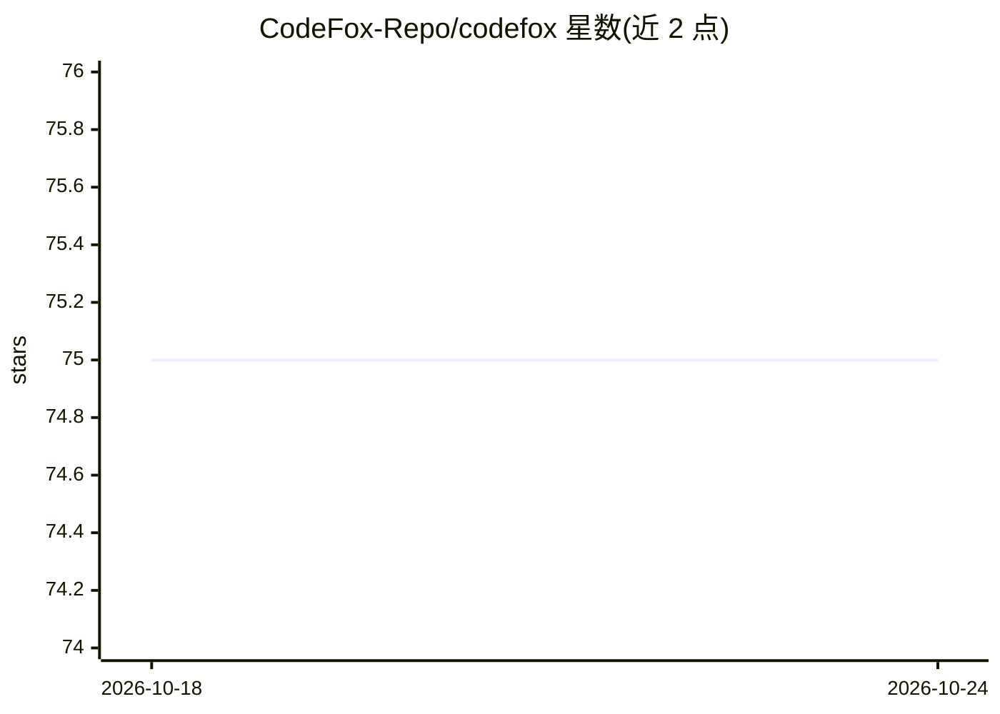

# CodeFox-Repo/codefox

⭐ 75 · TypeScript · MIT · 推送 2026-10-01 · [GitHub](https://github.com/CodeFox-Repo/codefox) · [官网](https://codefox-lac.vercel.app) · 组织维护

**给开发者的 AI 全栈页面生成器：对话生成项目并实时预览**

通过对话生成页面与全栈项目的 Web 应用：用户一句话描述需求，agent 先以问题卡片确认受众与设计方向再构建，产出 HTML 页面或运行 next dev 预览服务器；每轮对话对应一次 git 快照，可回滚到任意轮次；项目决策记入 NOTES.md 供 agent 每轮读取且不对外发布。支持发布分享链接、导出 zip/PDF、部署到用户自己的 Vercel 账号。默认内置 AI SDK 循环，可切换 Claude Code / Codex CLI 作为执行 harness；沙箱可选 host 或 Vercel microVM。需 Node.js >= 18 与 pnpm，聊天功能需配置 OpenAI 兼容端点的 API key（OpenRouter 为零配置选项）。

## 筛选速览

| 维度 | 判定 | 备注 |
|---|---|---|
| AI 角色 | `ai-native` | 本体是模型或模型工具 |
| 许可风险 | `permissive` | MIT |
| 部署形态 | `library` | 以包/库形式分发 |
| 模型依赖 | locked-api |  |
| 硬件要求 | — | 无带数字的原话,不猜 |
| 安装摩擦 | `low` | 无编译、无系统依赖或容器化 |
| 成熟度 | — | 结构信号不足 |

## 能力要点

- 首轮以问题卡片确认需求（受众/视觉方向/CTA）后再构建
- 每轮对话即一次 git 提交，可回滚并显示变更，含用户手改
- 预览即文件：HTML 直接渲染，next 项目起真实 dev server 并随轮次更新
- AGENT_HARNESS 可切换内置 AI SDK 循环 / Claude Code CLI / Codex CLI

## 适用场景

- 用一句话起一个落地页并边聊边改
- 在带版本快照的工作台里迭代生成全栈项目
- 把生成的页面一键分享、打包或部署到自己的 Vercel 账号

## 场景标签

`编码 Agent` · 领域:编码与开发

## 证据(README 行号)

> L7: Describe a page in a sentence. CodeFox scaffolds it on your disk, hands the
> L8: directory to a coding agent, and renders the result beside the chat — so what
> L30: **The preview is the file.** A page project renders the HTML the agent just
> L31: wrote; a `next` project gets a real `next dev` server on its own port. Both

## 星数曲线

2026-10-18 75 → 2026-10-24 75（+0）

---
*卡片 v1 · prompt 1.4 · 生成 2026-10-24 · 置信度 mid · 依据 README sha `3e2a75251092` · [字段定义](../../DATASET.md)*
