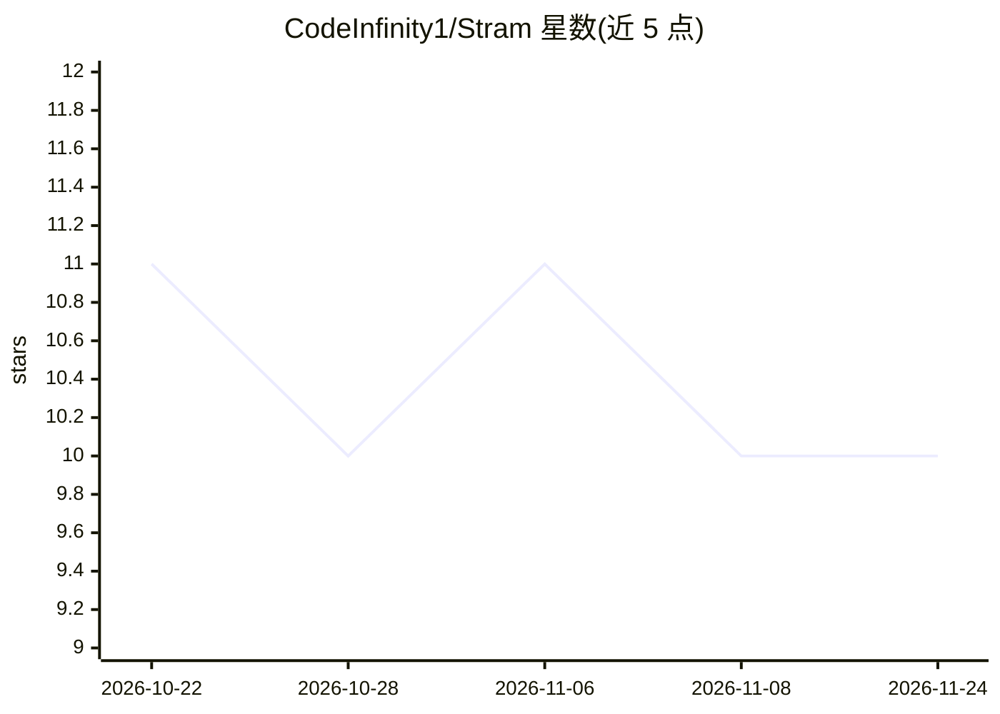

# CodeInfinity1/Stram

⭐ 10 · Python · MIT · 推送 2026-08-10 · [GitHub](https://github.com/CodeInfinity1/Stram) · 个人维护

**本地优先的主动式桌面认知 Agent，工具需审批后执行**

Stram 同时是运行时和 Agent 本体：通过收集器（collectors）读取桌面、浏览器、文件、应用、频道、语音与连接器事件，经刺激过滤与注意力排序形成工作场景，再按风险决定回答、等待、起草、监控、调用工具或请求人工审批。工具按风险分级，高风险动作暂停待批并留审计痕迹；记忆按目标、承诺、教训、技能等分槽持久化。提供 Windows EXE 与 macOS PKG 桌面安装包，依赖用户自己的模型 API key。

## 筛选速览

| 维度 | 判定 | 备注 |
|---|---|---|
| AI 角色 | `ai-native` | 本体是模型或模型工具 |
| 许可风险 | `permissive` | MIT |
| 部署形态 | `desktop` | 安装包/桌面程序 |
| 模型依赖 | local-ok | 支持本地模型 |
| 硬件要求 | — | 无带数字的原话,不猜 |
| 安装摩擦 | `medium` | 含编译或系统依赖之一 |
| 成熟度 | — | 结构信号不足 |

## 能力要点

- 主动唤醒机制：可由计划任务、文件变更、频道事件、语音转录、连接器事件触发，不限于聊天输入
- 审批门控工具：shell、浏览器写入、截图、外发、代码执行等高风险动作暂停等待人工批准
- 分槽持久记忆：目标、承诺、环境事实、教训、可复用工作流跨会话保留
- 本地 REST 运行时面：/stimuli、/channels、/approvals、/memory、/collectors 等统一接口供桌面客户端调用

## 适用场景

- 离开电脑时让 Agent 监控构建/CI 输出，失败时给出修复计划并等待批准再改文件
- Slack 等频道来消息时自动起草回复，发送前需人工确认
- 会议结束后提取行动项元数据并生成跟进任务
- 对高风险桌面自动化动作要求审批与审计痕迹

## 场景标签

`GUI 自动化` `AI 助手` · 领域:效率与自动化

## 证据(README 行号)

> L14: **A proactive, local-first cognitive agent that works with you like a 24/7 assistant companion.**
> L16: Stram is both the runtime and the agent that uses it: a local-first cognitive agent, not a chatbot waiting for the 
> L48: |Use real tools|Operate browser, files, shell, code, OS surfaces, channels, voice, memory, providers, and connector

## 星数曲线

2026-10-22 11 → 2026-11-24 10（-1）

---
*卡片 v1 · prompt 1.4 · 生成 2026-11-20 · 置信度 high · 依据 README sha `afa187818f27` · [字段定义](../../DATASET.md)*
